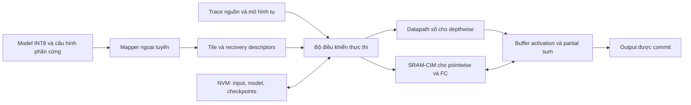

# KẾ HOẠCH NGHIÊN CỨU: RECAP-CIM

## Recovery-Aware Fused Mapping for Intermittent TinyML on Volatile SRAM Compute-in-Memory

**Tên tiếng Việt:** Đồng tối ưu ánh xạ và phục hồi suy luận TinyML trên SRAM-CIM khi nguồn điện gián đoạn.

| Thông tin | Nội dung |
|---|---|
| Phiên bản | 3.1 — cập nhật theo 6 điểm cần xử lý trước thí nghiệm |
| Ngày cập nhật | 2026-01-XX (cần cập nhật ngày thực tế) |
| Nguồn lực hiện có | Máy tính để huấn luyện và mô phỏng; chưa giả định FPGA, PDK, giấy phép EDA hoặc ngân sách tape-out |
| Loại nghiên cứu | Phương pháp ánh xạ tự động và đồng thiết kế phần cứng/phần mềm, được đánh giá bằng mô phỏng có căn cứ và kiểm chứng RTL |
| Ứng dụng chính | Keyword spotting với DS-CNN INT8 |
| Mục tiêu công bố | Một bài nghiên cứu có phản biện tại hội nghị/tạp chí IEEE phù hợp với mức bằng chứng đạt được |
| Trạng thái | Đề xuất nghiên cứu; chưa có kết quả hiệu năng được xác minh |

> Hướng mới đề xuất là lựa chọn đồng thời cách chia phép tính, tái sử dụng trọng số và trạng thái cần lưu để giảm chi phí phục hồi của SRAM-CIM sau mất nguồn. Tính mới là giả thuyết cần kiểm tra bằng khảo sát đầy đủ và thực nghiệm; không tuyên bố "first", không cam kết được nhận bài, không ghi mục tiêu như kết quả đã đạt.

---

## 1. Tóm tắt và quyết định định hướng

SRAM-CIM có thể giảm một phần di chuyển dữ liệu khi suy luận. Tuy nhiên, SRAM mất nội dung khi mất nguồn hoàn toàn. Trọng số thường trú trong mảng, activation, partial sum và trạng thái bộ điều khiển có thể phải được nạp hoặc tính lại. Vì vậy, ánh xạ tối ưu cho nguồn liên tục chưa chắc tối ưu khi nguồn gián đoạn.

Đề tài tập trung vào một tình huống cụ thể: thực hiện cặp **depthwise convolution (DW) → requantization/activation → pointwise convolution (PW)** của DS-CNN trên một hệ thống dùng SRAM-CIM cho PW và datapath số cho DW. Khi nguồn xuống thấp, hệ thống phải lựa chọn giữa lưu đầu ra DW để khôi phục nhanh hoặc bỏ đầu ra DW và tính lại từ đầu vào bền vững. Quyết định này phụ thuộc kích thước tensor, mức tái sử dụng, tiến độ PW, trọng số còn trong SRAM và chi phí bộ nhớ không mất dữ liệu (NVM).

**Giả thuyết trung tâm:** Đồng tối ưu điểm lưu trạng thái, thứ tự và kích thước tile, với chi phí nạp lại trọng số được mô hình hóa rõ ràng, có thể giảm năng lượng để hoàn thành suy luận so với ánh xạ CIM thông thường ghép thêm checkpoint theo lớp hoặc theo tile cố định.

Kế hoạch cơ sở sử dụng máy tính: benchmark thật, mô hình INT8 chính xác theo bit, simulator theo sự kiện/chu kỳ, thuật toán ánh xạ và RTL bộ điều khiển phục hồi. Không đặt chế tạo chip là điều kiện để hoàn thành đề tài. Các kết luận về SRAM-CIM vật lý phải giới hạn theo dữ liệu macro và mức kiểm chứng có được.

### 1.1 Vì sao chọn hướng này?

| Hướng | Đánh giá | Quyết định |
|---|---|---|
| SRAM-CIM + INT8 + TinyML nói chung | Đã có nhiều công trình; khó bảo vệ tính mới chỉ bằng tổ hợp này | Không dùng làm đóng góp trung tâm |
| Thiết kế cell analog/ADC mới | Có thể có đóng góp mạch, nhưng cần PDK và kiểm chứng transistor/layout | Để ngoài phạm vi cơ sở |
| Điều chỉnh số tile theo năng lượng | Đã có hướng thích nghi mức song song như Viadotto [R3] | Dùng làm đối chứng khi phù hợp |
| Đồng tối ưu phục hồi và ánh xạ DW–PW trên SRAM-CIM dễ mất dữ liệu | Có cơ chế cụ thể, thí nghiệm được với nguồn lực hiện có, có khả năng tạo khác biệt | Hướng được chọn; kiểm tra tính mới ở G1 |

### 1.2 Ranh giới phạm vi

- Một kiểu số học chính: INT8 weight/activation, tích lũy INT32 và quy tắc requantization cố định.
- Một đóng góp phương pháp chính: recovery-aware mapper, đi kèm bộ điều khiển thực hiện quyết định đã sinh.
- Hai workload cho bài đầy đủ: DS-CNN KWS và một mạng depthwise-separable thứ hai có dữ liệu thật.
- Không thêm on-chip learning, early exit hoặc precision thích nghi vào bài cơ sở.
- Không giả định SRAM giữ trọng số qua mất nguồn; retention chỉ là một biến thể đánh giá.
- Không khẳng định perpetual/always-on batteryless KWS nếu chưa đánh giá cả thu âm và tiền xử lý.

---

## 2. Khoảng trống nghiên cứu và kiểm tra tính mới

### 2.1 Các nghiên cứu gần nhất

| Công trình | Điều đã có | Hệ quả cho RECAP-CIM |
|---|---|---|
| PSCNN, ISCAS 2022 [R1] | SRAM-CIM cho KWS, lập trình và tối ưu thực thi mạng nhị phân | Không tuyên bố SRAM-CIM KWS là mới; không so TOPS/W nhị phân trực tiếp với INT8 |
| KWS với in-SRAM computing và on-chip learning, TVLSI 2022 [R2] | KWS, mô hình nhận biết IMC, bù sai số và học trên chip | Không lấy QAT, KWS hoặc học trên chip làm khác biệt chung |
| Viadotto, ACM TECS 2025 [R3] | CIM trên CRAM không mất dữ liệu, mức song song thích nghi với nguồn | **Quan trọng:** Viadotto dùng CRAM (không mất dữ liệu) → không cùng problem domain với volatile SRAM. So sánh chỉ ở mức mapping strategy |
| CHRYSALIS, ISCA 2024 [R4] | Công cụ đồng thiết kế năng lượng, phần cứng suy luận và dataflow | Không tuyên bố đồng tối ưu năng lượng/dataflow hoặc tìm tile tối ưu là mới |
| Chime, IEEE TMSCS 2016 [R5] | Đặt checkpoint để giảm chi phí tính lại, có thích nghi với năng lượng | **Quan trọng:** Chime tối ưu checkpoint granularity nhưng **không xét trạng thái trọng số trong SRAM**. Đây là điểm khác biệt dự kiến cần xác minh |
| FreeML, 2024 [R6] | Suy luận thích nghi năng lượng và tiết kiệm bộ nhớ trên hệ thống batteryless | Không thêm early exit rồi xem đó là đóng góp mới |
| FERMI-ML, 2025 [R7] | Macro SRAM cho TinyML và precision cấu hình được, đánh giá post-layout | Macro CIM/TinyML có thể làm nền tảng; không lấy số macro làm số toàn hệ thống |

Đây là khảo sát định hướng, không phải khảo sát đầy đủ chứng minh tính mới. Tên tuổi công trình không thay thế cho việc đọc phương pháp, thuật toán và mô hình chi phí của chúng.

### 2.2 Phát biểu tính mới dự kiến (cần xác minh ở G1)

> RECAP-CIM khảo sát việc đồng lựa chọn cấu hình tile DW–PW, trạng thái trọng số trong SRAM, trạng thái trung gian cần lưu hoặc tính lại, và thứ tự tái sử dụng trọng số trên SRAM-CIM dễ mất dữ liệu; mục tiêu là giảm chi phí hoàn thành suy luận sau các lần mất nguồn mà giữ nguyên kết quả INT8.

**Điểm khác biệt dự kiến cần xác minh ở G1:**

| So sánh | Chime [R5] | Viadotto [R3] | RECAP-CIM (dự kiến) |
|----------|-------------|---------------|----------------------|
| **Xét trạng thái trọng số trong SRAM** | Cần xác minh | Không (CRAM) | Có (cần xác minh) |
| **DW–PW fusion structure** | Cần xác minh | Cần xác minh | Có (cần xác minh) |
| **Đồng tối ưu tile + recovery policy** | Cần xác minh | Cần xác minh | Có (cần xác minh) |
| **Weight reload cost trong decision** | Cần xác minh | Cần xác minh | Có (cần xác minh) |
| **Chi phí ghi vs recovery phân biệt** | Cần xác minh | Cần xác minh | Có (cần xác minh) |

> **Lưu ý quan trọng:** Bảng trên là "dự kiến" — cần xác minh bằng đọc full text của các công trình trước khi khẳng định. "Khác với X" ≠ "chưa từng được công bố".

**Ba thành phần cần được chứng minh cùng nhau (sau G1):**

1. **Mô hình chi phí có trạng thái cư trú trọng số:** phân biệt trọng số đang có trong SRAM, trọng số phải nạp do đổi tile và trọng số phải nạp do mất nguồn.
2. **Lựa chọn trạng thái phục hồi theo cấu trúc DW–PW:** xác định khi nào lưu activation DW là rẻ hơn tính lại; tính cả chi phí đọc đầu vào bền vững, nạp trọng số và lưu partial sum PW.
3. **Mapper tạo phương án thực thi hợp lệ:** sinh tile, thứ tự vòng lặp, điểm commit và recovery descriptor; bộ điều khiển thực thi được, đầu ra khớp reference sau power failure.

Double buffering, CRC, checkpoint và fusion là kỹ thuật đã biết. Vai trò của chúng là thực hiện phương pháp đúng; không mặc định tính chúng là đóng góp mới riêng.

### 2.3 G1 — mốc bắt buộc xác minh tính mới ở tuần 4

- Đọc khoảng 20–30 công trình sát nhất; ưu tiên full text và tài liệu/mã nguồn của tác giả.
- Tìm các từ khóa: intermittent SRAM-CIM; recovery-aware mapping; checkpoint/recomputation; fused depthwise-pointwise; volatile weight reload; NVM traffic; intermittent inference dataflow.
- Bổ sung công trình mới đến thời điểm chuẩn bị nộp.
- **Lập bảng từng quyết định của thuật toán** (state, action, transition cost), đối chiếu với Chime, Viadotto, CHRYSALIS và các công trình gần hơn được tìm thấy. Mỗi nhận xét "X chưa có" phải dẫn đến trang/công thức cụ thể trong paper gốc.
- Tách rõ "công trình không báo cáo tính năng" với "công trình không có tính năng"; không suy luận vắng mặt từ abstract.
- Nếu tổ hợp quyết định đã được công bố hoặc khác biệt chỉ là đổi tên, phải sửa vấn đề nghiên cứu trước khi triển khai lớn.

**Điều kiện qua G1:** có một phát biểu khác biệt kỹ thuật rõ ràng, một baseline gần nhất và một thí nghiệm có thể bác bỏ hoặc xác nhận lợi ích của khác biệt đó.

### 2.4 Song song: Chọn hardware configuration (tuần 2-4)

**Ưu tiên cao:** Việc chọn SRAM-CIM macro và NVM ảnh hưởng trực tiếp đến kết luận SAVE_DW vs REPLAY_DW. Thực hiện song song với G1.

**Deliverable tuần 4:**
- Một SRAM-CIM macro có dữ liệu: throughput, precision, compute energy, weight loading energy, loading latency
- Một NVM có dữ liệu: read/write energy, write endurance, persistence latency
- Bảng tham số với nguồn và nhãn `measured`/`post-layout`/`reported`/`assumed`

**Nếu không tìm được dữ liệu đáng tin:**
- Giới hạn miền tham số dựa trên công nghệ (ví dụ: NOR flash vs FRAM vs MRAM)
- Báo sensitivity trên miền rộng
- Không dùng số năng lượng tuyệt đối làm kết luận chính

---

## 3. Câu hỏi nghiên cứu, giả thuyết và tiêu chí thành công

| Câu hỏi | Giả thuyết cần kiểm tra | Phép kiểm tra |
|---|---|---|
| RQ1: Ánh xạ tối ưu cho nguồn liên tục mất hiệu quả bao nhiêu khi SRAM mất trọng số? | Chi phí nạp lại và lưu trạng thái làm thay đổi lựa chọn tile/dataflow | Đo breakdown và đổi thứ hạng mapping theo cùng supply trace |
| RQ2: Lưu hay tính lại trung gian DW trong điều kiện nào có lợi? | Tồn tại miền chi phí mà mỗi lựa chọn thắng; luôn lưu hoặc luôn tính lại đều có trường hợp kém | Sweep kích thước tensor, NVM cost, SRAM size và tiến độ PW |
| RQ3: Đồng tối ưu hai quyết định có tốt hơn tối ưu từng quyết định riêng? | Mapper kết hợp cho lợi ích vượt quá một thành phần đơn lẻ | Ablation với cùng hardware budget và cùng arithmetic |
| RQ4: Phục hồi có bảo toàn kết quả và tiến độ không? | Với input bền vững và commit hợp lệ, đầu ra INT8 khớp reference bất kể vị trí mất nguồn | Fault injection có hệ thống; mô hình trạng thái; RTL trace comparison |
| RQ5: Lợi ích có bền vững trước sai số mô hình năng lượng? | Xu hướng không chỉ tồn tại ở một bộ tham số thuận lợi | Tham số có nguồn, validation tách riêng, sensitivity và corner cases |

### 3.1 Tiêu chí nội bộ — không phải kết quả hoặc yêu cầu cố định của IEEE

- Kết quả sau phục hồi khớp theo bit với reference INT8 trong tất cả test đã thực hiện; không chỉ kiểm tra nhãn phân loại.
- **Định nghĩa năng lượng thống nhất (xem mục 7.6):**
  \[
  E_{\mathrm{completed}}=\frac{\text{tổng năng lượng tiêu thụ trong toàn bộ khoảng đánh giá}}{\text{số suy luận hoàn thành}}
  \]
  Tổng năng lượng bao gồm: compute, checkpoint ghi, boot, restore, reload trọng số, tính lại và cả các tác vụ thất bại.
- **Quy tắc kết luận "tốt hơn":**
  - Phương án A tốt hơn B khi:
    - `E_completed(A) < E_completed(B)` (theo định nghĩa thống nhất ở trên)
    - **VÀ** `completion_rate(A) >= completion_rate(B) - 5 điểm phần trăm tuyệt đối`
    - **VÀ** `latency_p95(A) <= latency_p95(B)` (tính trên **tất cả** input, không chỉ completed)
  - δ = 5 điểm phần trăm tuyệt đối: ví dụ, B hoàn thành 80%, A hoàn thành 75% → được chấp nhận; A hoàn thành 74% → không đủ điều kiện
  - Latency p95 tính trên **tất cả** inference, không chỉ completed — để tránh bỏ qua tác vụ khó
- Báo cáo cả trường hợp không cải thiện hoặc kém hơn; mức 20% là mốc quyết định nội bộ, không dùng làm lý do chọn lọc kết quả.
- Mục tiêu overhead bộ điều khiển/descriptor: không quá 10% so với cấu hình thực thi tương ứng nếu có cùng flow tổng hợp và dữ liệu macro; nếu không có dữ liệu macro, báo cáo overhead tuyệt đối và giới hạn so sánh.
- Không đánh đổi accuracy bằng precision/early exit trong bài cơ sở. Độ chính xác phụ thuộc mô hình INT8 được chọn, không gán trước 94%.
- Công cụ phải chạy được trên ít nhất hai workload và nhiều chế độ năng lượng cho bản journal đầy đủ. Một bài ngắn có thể chỉ dùng KWS nhưng kết luận phải giới hạn tương ứng.

---

## 4. Hệ thống và phương pháp được đề xuất

### 4.1 Kiến trúc nghiên cứu



Datapath DW thông thường là lựa chọn ban đầu để tránh giả định DW luôn tận dụng tốt mảng CIM. Thử DW trên CIM chỉ là cấu hình so sánh nếu macro và mapping hỗ trợ.

**Phân biệt mức mô hình:** SRAM-CIM trong simulator là backend có interface, timing và cost model được mô tả. Mã Verilog nhân/cộng quanh SRAM hoặc FPGA BRAM chỉ chứng minh hành vi thực thi. Chỉ gọi triển khai là SRAM-CIM vật lý khi có cấu trúc memory-compute được kiểm chứng phù hợp.

### 4.2 Không gian quyết định

Với mỗi cặp DW–PW, mapper xét:

- Kích thước tile không gian `T_h × T_w`, kể cả halo đầu vào DW.
- Khối kênh đầu vào `T_ci` và khối kênh đầu ra `T_co`.
- Thứ tự duyệt kênh và tile không gian: ảnh hưởng tái sử dụng weight và activation.
- Biên fusion: giữ trung gian DW trong SRAM, hoặc materialize vào NVM ở một ranh giới được chọn.
- **Trạng thái trọng số:** chi tiết theo mục 4.4.1
- Policy phục hồi `SAVE_DW` hoặc `REPLAY_DW` tại các biên đã được mapper xác nhận hợp lệ.
- Granularity commit của đầu ra/partial sum PW; không đổi thứ tự toán học nếu việc đổi gây khác kết quả requantization hoặc overflow.

Các lựa chọn bị ràng buộc bởi SRAM, NVM bandwidth, năng lượng khả dụng, độ rộng accumulator và tính hợp lệ của dependency. Policy trực tuyến chỉ chọn trong tập descriptor hợp lệ đã sinh ngoại tuyến.

### 4.3 Mô hình năng lượng để ra quyết định

Với một chu kỳ nguồn đang hoạt động, không giả định có thể biết trước lần mất nguồn tiếp theo:

\[
E_{cap}(t)=\frac{1}{2}C\max\left(0,V(t)^2-V_{off}^2\right).
\]

Năng lượng ở tải phải tính hiệu suất chuyển đổi, năng lượng khởi động và sai số cảm biến. Điều kiện admission bảo thủ cho một đơn vị tiến độ:

\[
E_{unit}(d,r)+E_{commit}(d)+E_{margin}\le E_{available}(t).
\]

Ở đây `d` là descriptor, `r` là trạng thái trọng số cư trú; `E_unit` bao gồm đọc input, nạp weight, DW, PW, xử lý số và leakage. Không cộng năng lượng tương lai chưa thu được vào bảo đảm an toàn. Kết quả thu hoạch được trong lúc chạy vẫn được đưa vào mô phỏng nguồn thực tế.

**Chi phí phục hồi phải phân tách rõ hai loại:**

\[
E_{recovery}=E_{boot}+E_{metadata}+E_{restore}+E_{weight\ reload}+E_{replay}.
\]

**So sánh SAVE_DW vs REPLAY_DW — chi phí thành phần:**

> **Sửa đổi quan trọng:** REPLAY_DW không có chi phí ghi DW, nhưng **vẫn có thể cần ghi partial sum PW** nếu muốn giữ tiến độ PW. Hai trường hợp cần phân biệt:

| Chi phí | SAVE_DW | REPLAY_DW (giữ PW progress) | REPLAY_DW (không giữ PW) |
|---------|---------|-------------------------------|---------------------------|
| **Ghi DW activation** | `E_write(Z_DW)` | 0 | 0 |
| **Ghi PW partial sum** | `E_write(PS_PW)` (nếu cần) | `E_write(PS_PW)` (nếu cần) | 0 |
| **Đọc DW activation sau failure** | `E_read(Z_DW)` | 0 | 0 |
| **Replay DW computation** | 0 | `E_DW_compute` | `E_DW_compute` |
| **Replay PW partial** | 0 | 0 | `E_PW_partial` (có thể lớn) |

**Điểm quan trọng:** Nếu muốn tiếp tục PW từ channel 17 sau reboot mà không replay toàn bộ PW, phải lưu partial sum. Nếu không lưu, phải tính lại từ channel 0.

**Công thức chi phí có điều kiện:**

\[
\widehat E_{save}=E_{write}(Z_{DW})+E_{write}(PS_{PW})\cdot\mathbf{1}_{keep\_pw}+E_{metadata}^{save}+p_{fail}\cdot E_{boot\_read\_DW},
\]

\[
\widehat E_{replay}=p_{fail}\cdot\left(E_{boot}+E_{read}(X_{anchor})+E_{reload}(W_{DW})+E_{DW\ replay}+E_{PW\_replay}\cdot\mathbf{1}_{!keep\_pw}\right),
\]

Trong đó `p_fail` là xác suất mất nguồn trong khoảng tiến độ tiếp theo (xem mục 4.4.3 cho cách ước lượng).

Mapper còn phải tính partial sum PW, reload PW, số lần dùng lại `Z_DW`, checkpoint đã tồn tại và năng lượng cho lần phục hồi. Không cộng lặp phần chi phí chung.

### 4.4 Thuật toán chi tiết

#### 4.4.1 Định nghĩa formal — phiên bản cải tiện

**Trạng thái (State):**
```
s = (b, t, ci_sram_valid, ci_nvm_saved, co_done, 
     weight_banks, anchor_durable, checkpoint_state, power_state)
```

| Thành phần | Miền | Ý nghĩa |
|------------|------|---------|
| `b` | {BLOCK_0, ..., BLOCK_{N-1}} | Block DW-PW hiện tại |
| `t` | {(th, tw) ∈ valid_tiles} | Tọa độ tile không gian |
| `ci_sram_valid` | Bitmap hoặc [0, C_in) | Các channel đầu vào DW đã tính và còn trong SRAM |
| `ci_nvm_saved` | Bitmap hoặc [0, C_in) | Các channel đã lưu bền vững vào NVM |
| `co_done` | [0, C_out) | Offset kênh đầu ra PW đã commit |
| `weight_banks` | Bitmap + content | Bank nào chứa tile trọng số nào, số byte hợp lệ |
| `anchor_durable` | {VALID, INVALID} | Anchor input DW có bền vững trong NVM không |
| `checkpoint_state` | {NONE, DW_SAVED, PS_SAVED, BOTH_SAVED, COMMITTED} | Trạng thái checkpoint |
| `power_state` | {NOMINAL, MARGINAL, OFF, BOOTING} | Trạng thái nguồn |

**Tại sao weight_banks cần chi tiết hơn {ALL, PARTIAL, NONE}:**

```
Ví dụ:
- weight_banks = {bank_A: [W_tile_0..2], bank_B: [W_tile_3..5]}
- weight_banks = {bank_A: [W_tile_0..1], bank_B: [W_tile_4..6]}

Cả hai đều là PARTIAL, nhưng:
- Bước tiếp theo cần W_tile_2 → chi phí khác nhau
- Bước tiếp theo cần W_tile_3 → bank_A đủ vs bank_B đủ (khác nhau)
```

**Quy tắc chuyển trạng thái cơ bản:**

```
Transition(s, COMPUTE_DW(tile, ci_range)):
  - Tính DW trên các channel trong ci_range
  - Cập nhật ci_sram_valid: thêm ci_range
  - Nạp trọng số nếu cần → cập nhật weight_banks
  - anchor_durable không đổi (đọc X_anchor không làm anchor bền vững)

Transition(s, SAVE_DW_Z):
  - Ghi activation từ ci_sram_valid vào NVM
  - Cập nhật ci_nvm_saved: thêm các channel đã ghi
  - checkpoint_state' = DW_SAVED hoặc BOTH_SAVED
  - Phát sinh chi phí: E_write(z_DW) + E_metadata

Transition(s, BOOT_RECOVER):
  - Đọc checkpoint metadata
  - Xác định checkpoint_state từ payload đã commit
  - weight_banks' = EMPTY (tất cả SRAM đã mất)
  - ci_sram_valid' = {} (không có activation trong SRAM)
  - Chọn policy: 
    - Nếu DW đã lưu (ci_nvm_saved chứa đủ): khôi phục từ NVM
    - Nếu không: replay từ anchor
```

**Hành động hợp lệ (Actions):**
```
A(s) = {
  COMPUTE_DW(tile, ci_range)      -- Tính DW trên tile
  COMPUTE_PW(tile, ci_range, co) -- Tính PW trên tile  
  SAVE_DW                         -- Lưu DW activation vào NVM
  SAVE_PW_PS                      -- Lưu partial sum PW vào NVM
  COMMIT                          -- Commit output đã hoàn thành
  WAIT_CHARGE                     -- Chờ sạc tụ
  BOOT_RECOVER                    -- Khởi động sau mất nguồn
}
```

#### 4.4.2 Hàm chi phí chi tiết

**Chi phí ghi phát sinh bắt buộc (trước khi biết có failure hay không):**

| Hành động | Chi phí ghi | Điều kiện |
|-----------|-------------|-----------|
| `SAVE_DW` | `E_write(Z_DW)` + `E_metadata` | Phát sinh ngay |
| `SAVE_PW_PS` | `E_write(PS_PW)` + `E_metadata` | Phát sinh ngay nếu muốn giữ PW progress |
| `COMMIT` | `E_commit` + `E_meta_final` | Phát sinh khi commit |

**Chi phí phục hồi chỉ khi có failure:**

| Hành động | Chi phí khôi phục | Ghi chú |
|-----------|-------------------|---------|
| `BOOT_RECOVER` | `E_boot` + `E_read_meta` | Luôn phát sinh khi reboot |
| Restore từ NVM | `E_read(Z_DW)` hoặc `E_read(PS_PW)` | Tùy checkpoint state |
| Replay DW | `E_reload(W_DW)` + `E_DW_compute` | Nếu không có checkpoint |
| Replay PW partial | `E_PW_partial` | Nếu không lưu PS_PW |

#### 4.4.3 Ước lượng p_fail

**Vấn đề:** SAVE và REPLAY có thể có mức tiêu thụ khác nhau → ảnh hưởng xác suất mất nguồn → feedback loop.

**Giải pháp:**
1. Dùng `p_fail` từ trace history, **không từ dự đoán trên action hiện tại** cho quyết định mapper ngoại tuyến.
2. Simulator ghi nhận chi phí thực tế khi failure xảy ra.
3. Mapper ngoại tuyến dùng `p_fail` trung bình từ trace training.
4. **Không tính p_fail × cost_recovery** vào admission check (bảo thủ).

**Cửa sổ tính p_fail:**
- Cửa sổ: `window = expected_action_duration × safety_factor`
- `p_fail = P(outage_during_window | recent_trace_pattern)`
- Nếu không có đủ history: dùng `p_fail = avg_failure_rate` trên trace

#### 4.4.4 Thuật toán tối ưu

**Mục tiêu:**
\[
\min_{\pi}\;\mathbb{E}_{h\sim H_{train}}\left[E_{load}(0,\tau_{complete};\pi,h)\right].
\]

**Constraints:**
1. `footprint_SRAM(s) <= SRAM_capacity`
2. `E_unit(d, r) + E_commit(d) + E_margin <= E_available(t)` (admission)
3. `output INT8 == reference INT8` (bit-exact sau commit)
4. **Forward progress:** Số incomplete episodes có giới hạn; không dùng forward progress làm constraint có thể kiểm tra.

**Phương pháp giải:**

| Cấu hình | Phương pháp | Độ phức tạp | Ghi chú |
|----------|-------------|-------------|---------|
| Microbenchmark nhỏ | Vét cạn trạng thái trên chuỗi actions | O(\|S\|³) | Cần xác định rõ: đang sínt state hay policy |
| Mạng vừa | DP với state truncation | O(T × \|S\| × \|A\|) | Tùy thuộc cách định nghĩa S |
| Mạng lớn | Beam search với k best candidates | O(T × beam × \|A\|) | |

**Độ phức tạp O(|S| × |A|):** Đây là độ phức tạp cho **một bước** chuyển trạng thái, không phải cho toàn bộ quá trình tìm policy. Độ phức tạp tìm policy phụ thuộc vào horizon và cách duyệt.

**Mapper runtime:**
- Mapper ngoại tuyến chạy trên máy tính, không bị giới hạn năng lượng thiết bị.
- Runtime descriptor selection trực tuyến phải nhỏ: dùng LUT hoặc so sánh đơn giản.
- Mapper runtime **không so với inference energy** — đây là hai đại lượng khác nhau.

#### 4.4.5 Quy tắc số học

- Giữ đúng zero point, scale, bias, rounding, saturation và vị trí activation của mô hình reference.
- Fusion không được bỏ requantization giữa DW và PW.
- Ghi rõ INT8 signed/unsigned ở mọi interface; nếu bit-slicing bù hai, hệ số bit dấu phải được xử lý đúng.
- Chứng minh giới hạn tích lũy với số hạng lớn nhất; quy định overflow/accumulator width cho từng layer.
- Thay đổi vị trí checkpoint không được thay đổi trạng thái toán học. Đầu ra phục hồi phải khớp INT8 reference, không chỉ gần đúng.

---

## 5. Phục hồi đúng sau mất nguồn

### 5.1 Hai lựa chọn hợp lệ

**SAVE_DW:** Lưu trung gian DW cần cho phần PW chưa hoàn thành vào NVM, partial sum PW nếu muốn giữ tiến độ, offset kênh, tọa độ tile và metadata. Sau reboot, đọc từ NVM và tiếp tục.

**REPLAY_DW:** Không lưu trung gian DW. Sau reboot, đọc anchor input từ NVM, nạp trọng số DW, tính lại. Partial sum PW:
- **Giữ PW progress:** phải lưu partial sum PW (chi phí ghi tương đương SAVE_DW)
- **Không giữ PW progress:** tính lại PW từ đầu (chi phí tính lại có thể lớn)

**Quy tắc so sánh công bằng:** SAVE_DW và REPLAY_DW phải được so sánh ở cùng một mức tiến độ PW đã bảo toàn. Nếu REPLAY_DW không giữ PW progress, phải cộng thêm chi phí tính lại PW.

### 5.2 Đơn vị tiến độ và cấu trúc lưu bền vững

Checkpoint/commit record dự kiến gồm:

```text
generation, model_hash, input_id, block_id,
tile_coordinates, ci_saved_bitmap, ci_sram_valid_bitmap,
co_done, descriptor_id, recovery_policy,
anchor_reference, payload_references[], 
payload_lengths[], checkpoint_state, integrity_check
```

Payload gồm activation hoặc partial sum còn sống. Model/input được nhận dạng riêng để không phục hồi nhầm mẫu. Bitmap cho ci_saved để xác định chính xác phạm vi khôi phục.

### 5.3 Giao thức commit

1. Tính toán vào buffer tạm; checkpoint/đầu ra đã commit vẫn bất biến.
2. Ghi payload mới vào vùng chưa được checkpoint hiện hành tham chiếu. Có thể dùng hai slot hoặc copy-on-write; tính đủ dung lượng và chi phí.
3. Chờ NVM xác nhận dữ liệu bền vững theo thứ tự ghi đã quy định.
4. Ghi metadata và cuối cùng publish một commit marker trong đơn vị ghi nguyên tử được backend bảo đảm.
5. Sau reboot, chỉ chọn generation có record hợp lệ và payload đã hoàn tất; bỏ bản ghi đang dở.
6. Chỉ thu hồi slot/anchor cũ khi checkpoint mới đã commit và không còn dependency tới dữ liệu cũ.

Giả định minimum atomic write unit và persistence ordering phải được công bố. CRC giúp phát hiện dữ liệu lỗi, không thay thế bảo đảm nguyên tử. Nếu backend không có atomic marker thích hợp, cần giao thức metadata bổ sung và kiểm chứng tương ứng.

### 5.4 Các bất biến cần kiểm chứng

- Output đã commit cho một `input_id` không bị đổi bởi replay.
- Checkpoint mới không phá dữ liệu mà checkpoint cũ còn cần.
- Partial sum và offset luôn tương ứng với cùng tập đóng góp; không bỏ sót hoặc cộng lặp.
- Không phát `result_valid` khi còn đầu ra chưa commit.
- Power failure trong compute, DMA, payload write, metadata write hoặc commit đều phục hồi về một trạng thái hợp lệ.
- Forward progress chỉ được kết luận nếu có các khoảng nguồn đủ cho ít nhất một đơn vị tiến độ và commit; payload không thể lớn hơn năng lượng tối đa của tụ mà vẫn giả định hoàn tất.

---

## 6. Dữ liệu, benchmark và mô hình

### 6.1 Benchmark chính

**Keyword spotting:** sử dụng pipeline DS-CNN và Speech Commands của một phiên bản/commit cố định của MLPerf Tiny [R8]. Dùng mô hình INT8 reference khi phù hợp, tránh huấn luyện một mạng mới trước khi có baseline phần cứng đúng.

Ghi lại dataset version, danh sách lớp, chia train/validation/test, hash model, cách tiền xử lý, input shape thực tế, số MAC và dung lượng weight/activation. Không giữ các shape hoặc số MAC từ plan cũ nếu chưa kiểm tra model đã chọn. Dữ liệu tổng hợp chỉ phục vụ unit test, không phục vụ báo cáo accuracy KWS.

### 6.2 Workload thứ hai cho bài đầy đủ

Ưu tiên MobileNet nhỏ cho Visual Wake Words từ MLPerf Tiny [R8], vì có cặp DW–PW và footprint khác KWS. Chỉ chọn cấu hình có thể thực hiện dưới giới hạn bộ nhớ đã công bố. Nếu dùng width multiplier hoặc thay đổi model, gắn nhãn cấu hình nghiên cứu riêng, không nhận là kết quả MLPerf chính thức.

### 6.3 Phạm vi sensing và deadline

- Thí nghiệm cơ sở bắt đầu từ một input đã được capture và lưu bền vững; tính chi phí lưu/cấp input trong mức đánh giá tương ứng.
- Công bố riêng "inference-only" và "sensing + preprocessing + inference" nếu mức thứ hai có đủ dữ liệu để mô hình hóa.
- Với KWS, đo độ trễ từ timestamp của input. Một quyết định đúng nhưng đến sau deadline được tính là trễ.
- Không suy luận khả năng nhận wake word liên tục từ số suy luận offline/giây.

---

## 7. Phương pháp đánh giá với nguồn lực hiện có

### 7.1 Ba mức bằng chứng

| Mức | Việc thực hiện | Kết luận được phép |
|---|---|---|
| A — bắt buộc | INT8 reference, event/cycle simulator, trace nguồn, fault injection, mapper | Tính đúng trong mô hình và lợi ích theo các tham số/giả định được công bố |
| B — bắt buộc cho bài có tuyên bố phần cứng | RTL controller, traffic generator, backend functional model; đối chiếu chu kỳ/transaction; tổng hợp khi có flow/library phù hợp | Controller thực hiện được, overhead và timing trong phạm vi flow đã chạy |
| C — nâng cấp | FPGA, đo nguồn/NVM, custom macro SPICE/post-layout hoặc silicon khi có điều kiện | Chỉ thêm kết luận vật lý tương ứng với dữ liệu thực sự đo/mô phỏng |

Nguồn lực hiện tại ưu tiên A và B. Nếu B chưa tổng hợp được, không báo area/power ASIC. Flow tổng hợp standard cell của controller không xác minh năng lượng macro SRAM-CIM. Không đặt mặc định "65 nm, <2 mm², >5 TOPS/W".

### 7.2 Cost model và giới hạn độ tin cậy

- **Chọn macro digital SRAM-CIM có dữ liệu multi-bit đủ để xác định throughput, precision, compute energy và cách loading weight.** Việc chọn macro là deliverable tuần 4 (song song với G1), không giả định số đã có trong repo.
- **Chọn NVM với dữ liệu read/write energy, latency và endurance.** Ưu tiên FRAM (low write energy) hoặc NOR flash (có dữ liệu).
- Mỗi tham số có đơn vị, phạm vi khối, công nghệ, nguồn và nhãn `measured`, `post-layout`, `reported` hoặc `assumed`.
- Không dùng efficiency binary để dự đoán INT8; không trộn energy macro với whole-chip power.
- Nếu paper không cung cấp weight-load energy hay NVM transaction cost, dùng khoảng giả định có giải thích và sensitivity, không ghi một giá trị duy nhất như số đo.
- Simulator phải tính mọi lần read/write/reload/commit, kể cả retry, boot, controller, leakage và dữ liệu bị bỏ sau failure.
- So sánh relative giữa policy trên cùng backend có thể kiểm chứng tốt hơn số năng lượng tuyệt đối; vẫn kiểm tra xem lợi ích có đổi dấu khi tham số thay đổi.
- Cross-check số chu kỳ/traffic với RTL ở các cấu hình nhỏ và tách validation cases khỏi cases dùng để fit cost model. Với năng lượng không có phép đo độc lập, ghi rõ chưa validate vật lý.

### 7.3 Mô hình nguồn

- Mô phỏng `V_on`, `V_off`, tụ, tổn hao chuyển đổi và brownout; xử lý nguồn ở bước thời gian đủ nhỏ để bắt các transaction.
- Sweep dung lượng tụ khởi đầu `10/47/100/470 µF` và công suất thu hoạch `10/30/100/300 µW`; đây là miền khảo sát đề xuất, không phải đặc tính hệ thống đã đo.
- Ba nhóm nguồn: steady/interruption-free; nguồn biến động tổng hợp; ít nhất một nhóm trace thực có nguồn gốc tái lập được cho bài journal đầy đủ.
- Tìm trace công khai phù hợp hoặc dữ liệu nguồn do tác giả công bố. Nếu không có trace thực, giới hạn tuyên bố vào simulated intermittent supply và ghi hạn chế đó.
- Supply trace giống nhau cho mọi phương pháp. Thời điểm mất nguồn phát sinh từ tiêu thụ năng lượng và mô hình tụ; không ép các phương pháp có cùng số failure trong thí nghiệm chính.
- Dùng outage sequence cố định riêng cho kiểm tra tính đúng/chi phí phục hồi, không thay thế đánh giá nguồn ghép với tải.

### 7.4 Baseline tối thiểu

| ID | Phương pháp | Mục đích |
|---|---|---|
| B0 | Conventional digital backend (non-CIM), cùng INT8; chỉ so nếu cost model đủ tương đương | **Kiểm tra tính đặc thù SRAM-CIM**: nếu lợi ích tương tự trên cả B0, đóng góp nghiêng về intermittent mapping, không phải CIM-specific |
| B1 | SRAM-CIM với mapping tối ưu nguồn liên tục, checkpoint ở biên layer | Baseline thông thường |
| B2 | SRAM-CIM với checkpoint theo tile cố định, luôn lưu trạng thái còn sống | Tách lợi ích của granularity checkpoint |
| B3 | SRAM-CIM với energy-adaptive tile, không đồng tối ưu trạng thái DW và weight reload | Baseline thích nghi gần nhất trên cùng backend |
| B4 | Mapper/checkpoint theo chi phí từ phương pháp gần nhất có thể tái hiện | Đối chứng mạnh với prior art, chọn chính xác sau G1 |
| B5 | RECAP-CIM đầy đủ | Phương pháp đề xuất |
| O1 | Tối ưu vét cạn trên microbenchmark hoặc oracle biết trước trace | Upper bound; không coi là baseline triển khai được |

**Lưu ý về B0:** Nếu B0 cho thấy lợi ích tương tự RECAP-CIM, kết luận phải điều chỉnh: "Phương pháp đồng tối ưu mapping và phục hồi có giá trị cho suy luận dưới nguồn gián đoạn nói chung, không chỉ đặc thù SRAM-CIM." Tên bài thay thế đã được chuẩn bị ở mục 10.1.

B4 không được bỏ chỉ vì B1/B2 dễ thắng. Nếu không tái hiện được một công trình, dùng implementation được mô tả rõ, ghi "inspired by"; không gọi nó là reproduction chính xác. Viadotto dùng NVM-CIM khác SRAM-CIM, nên chủ yếu so quyết định điều khiển trên backend chung, không ghép số throughput tuyệt đối từ hai công nghệ.

### 7.5 Ablation bắt buộc

1. Full mapper nhưng đặt chi phí reload weight bằng 0 trong quyết định; simulator vẫn tính reload thật.
2. Always-save DW so với always-replay DW và lựa chọn theo chi phí.
3. Mapping cố định + policy phục hồi; mapping thích nghi + policy phục hồi cố định; đồng tối ưu cả hai.
4. Fusion thông thường tối ưu cho nguồn liên tục so với fusion được chọn theo chi phí phục hồi.
5. Checkpoint toàn bộ trạng thái còn sống so với checkpoint tối thiểu hợp lệ.
6. Không gián đoạn, gián đoạn nhẹ/nặng và trường hợp nguồn không đủ để tiến độ; báo cáo overhead hoặc thất bại tương ứng.
7. **Ablation B0 vs B5:** So sánh trực tiếp để xác định lợi ích đặc thù SRAM-CIM hay chung cho intermittent inference.

### 7.6 Metrics và cách tổng hợp

**Định nghĩa năng lượng thống nhất (sửa đổi):**

\[
E_{\mathrm{completed}}=\frac{\text{tổng năng lượng tiêu thụ trong toàn bộ khoảng đánh giá}}{\text{số suy luận hoàn thành}}:
\]

**Tổng năng lượng bao gồm:**
- Compute (DW, PW, FC)
- NVM read/write cho mọi operation (bao gồm cả thất bại)
- Boot và restore sau mỗi failure
- Weight reload (kể cả do tile switch và do power loss)
- Leakage trong thời gian đánh giá
- Controller overhead
- **Không loại trừ bất kỳ thành phần nào**

**Các metric bổ sung:**
- `N_completed`, `N_incomplete`, `N_failed` — báo cáo riêng
- `completion_rate = N_completed / N_total`
- `E_completed` — chỉ có nghĩa khi `N_completed > 0`; nếu `N_completed = 0`, báo "không hoàn thành"
- `latency_p95` — tính trên **tất cả** input (bao gồm incomplete), không chỉ completed

**Quy tắc tổng hợp khi có incomplete cases:**
- Báo cáo riêng từng metric cho completed/incomplete/failed
- `E_completed` chỉ so sánh khi cùng completion rate (δ = 5 điểm phần trăm tuyệt đối)
- Kết luận "tốt hơn" khi:
  - `E_completed(A) < E_completed(B)`
  - `completion_rate(A) >= completion_rate(B) - 5 điểm phần trăm tuyệt đối`
  - `latency_p95(A) <= latency_p95(B)` (tính trên tất cả input)

Hai chế độ workload: một input outstanding để khảo sát cost/completion; luồng có arrival timestamp để khảo sát deadline và drop. Quy tắc queue/drop được cố định cho mọi baseline.

Nếu tổng hợp TOPS/W, ghi quy ước MAC=1 hay 2 operations, precision và phạm vi energy. Không dùng TOPS/W peak làm bằng chứng chính cho bài này.

### 7.7 Số lần chạy và thống kê

- Ít nhất 3 nhóm trace nguồn; khởi đầu ít nhất 10 seed/trace tổng hợp độc lập cho mỗi cấu hình chính.
- Chia trace tuning/validation/test; policy không được chỉnh theo test traces.
- Báo từng trường hợp và paired improvement trên cùng trace; tổng hợp median hoặc geometric mean khi phù hợp.
- Khoảng tin cậy 95% bằng bootstrap theo trace/seed độc lập; không coi các inference liên tiếp trong một trace là mẫu độc lập.
- Fault injection: vét cạn vị trí failure trên microtile nhỏ ở mỗi pha commit; thêm ít nhất 1.000 lịch failure ngẫu nhiên có seed cho cấu hình lớn.
- Chạy sensitivity với NVM cost, load bandwidth, compute cost, leakage và safety margin; chọn miền từ nguồn dữ liệu, bổ sung stress case để kiểm tra giới hạn.

---

## 8. Kế hoạch triển khai trong repository

Các đường dẫn dưới đây là cấu trúc cần tạo hoặc cập nhật khi thực hiện, không phải các artifact đã tồn tại.

```text
02_Research/
  novelty_matrix.md           # Đối chiếu quyết định với prior art (state/action/cost)
  references.bib             # DOI và citation đã kiểm tra
  hardware_selection.md       # SRAM-CIM macro + NVM với dữ liệu
03_Architecture/
  recovery_spec.md           # Dependency, descriptor và commit protocol
  cost_model_schema.md      # Đơn vị, nguồn và phạm vi tham số
  algorithm_spec.md          # State, action, transition, cost function chi tiết
04_RTL/
  recovery_controller.sv     # Bộ điều khiển, không giả danh macro vật lý
  descriptor_engine.sv
  nvm_transaction_model.sv
05_Model_Training/
  export_reference_int8.py   # Model/dataset thật và golden tensors
09_Simulation/
  recap_simulator.py         # Nguồn ghép với tải, memory traffic, failure
  mapper.py                  # DP/beam search với state/action/cost rõ ràng
  fault_injection.py
  configs/                  # Model/backend/NVM/trace parameters
  traces/                   # Trace hoặc manifest tải trace + provenance
10_Experiments/
  manifests/                # Commit/hash/seed/config của từng run
  raw/                      # CSV/JSON gốc
  plots/                    # Figure tái sinh từ dữ liệu gốc
  reproduce.md
07_IEEE_Paper/
  recap_cim_paper.tex        # Chỉ đưa kết quả đã xác minh
```

### 8.1 Tận dụng và sửa phần cũ

- Giữ plan v1/v2/v3 trong file backup để tham khảo lịch sử.
- Chương trình huấn luyện hiện dùng dữ liệu ngẫu nhiên: thay pipeline đánh giá bằng benchmark thật trước khi đưa accuracy vào bài.
- `imc_array.v` hiện là behavioral model: xác định lại vai trò backend, sửa lỗi bộ đếm và interface kết quả; kiểm chứng MVM trước khi dùng làm golden backend.
- `compare_results.py` và test-vector generator có thể tái sử dụng sau khi kiểm tra signedness, requantization và tiêu chí so sánh.
- Assertions hiện có chưa phải bằng chứng formal đã chạy; bổ sung properties cho commit/replay và lưu kết quả tool thật.
- ASIC Tcl hiện là flow tham khảo; không coi việc có script là đã chạy synthesis/PnR.
- README, architecture specification và bài LaTeX cũ còn chứa kết quả/tuyên bố chưa xác minh. Khi bước vào triển khai, cập nhật đồng bộ chúng theo plan v3.1; hiện không dùng các con số đó làm baseline hoặc kết quả.

### 8.2 Môi trường công cụ

Python cho reference/simulator/mapper; framework ML phù hợp model reference; Verilator hoặc Icarus Verilog cho RTL; Yosys cho tổng hợp logic khi backend hỗ trợ; SymbiYosys hoặc tool tương đương cho properties nhỏ nếu sẵn có. Ghi phiên bản, dependency lock và cách chạy trên máy cá nhân; WSL/Linux là tùy chọn triển khai, không giả định đã cài.

Không dùng tool thương mại hoặc PDK chưa có quyền truy cập. Thông số macro được trích từ nguồn có thể kiểm tra; nếu có PDK sau này, tạo một nhánh đánh giá riêng và không trộn công nghệ với kết quả cơ sở.

---

## 9. Lộ trình 32 tuần và mốc quyết định

Tuần tính từ ngày bắt đầu triển khai được chốt. Lộ trình dự kiến cho một người làm nghiên cứu đều đặn trên máy tính; điều chỉnh sau hai tuần profiling. Mọi giai đoạn dưới đây cộng thành 32 tuần, không bao gồm chế tạo chip.

| Tuần | Công việc | Deliverable/mốc quyết định |
|---|---|---|
| 1–4 | Đọc prior art, chốt khoảng trống, kiểm tra model KWS và môi trường + **chọn SRAM-CIM macro và NVM** | **G1:** novelty matrix (state/action/cost), research question, baseline gần nhất, **hardware selection với dữ liệu** |
| 5–8 | INT8 reference, cost schema, backend macro, simulator nguồn/memory cơ sở | G2: golden tensors, baseline breakdown, tham số có nguồn |
| 9–12 | Thử SAVE_DW/REPLAY_DW và mapping trên microbenchmark; mapper bản đầu | G3: lợi ích hoặc giới hạn có thể tái lập; chọn tiếp tục/sửa hướng |
| 13–16 | Thiết kế protocol phục hồi và RTL controller; so transaction với simulator | G4: correctness/fault tests đạt, invariants được kiểm tra |
| 17–20 | Tích hợp mapper/runtime, KWS end-to-end, baseline thích nghi và overhead | G5: kết quả trên test traces, không chỉ traces dùng tuning |
| 21–24 | Workload thứ hai, trace thực nếu có, sensitivity và toàn bộ ablation | G6: đánh giá đa workload; phân tích trường hợp thua |
| 25–28 | Tái lập, cross-validation mô hình, kiểm tra novelty mới, figure và bảng | Bộ artifact chạy lại được; lựa chọn venue theo bằng chứng |
| 29–32 | Viết bài tiếng Anh, review nội bộ, chỉnh sửa và chuẩn bị submission | G7: bản thảo đủ bằng chứng hoặc báo cáo rõ phần còn thiếu |

### 9.1 G1 — Novelty và Hardware Selection song song

**Deliverable 1: Novelty Matrix**
- Bảng đối chiếu từng quyết định (state, action, transition cost) với Chime, Viadotto, CHRYSALIS
- Mỗi nhận xét "X chưa có" phải dẫn đến trang/công thức cụ thể trong paper gốc
- Xác định điểm khác biệt dự kiến: weight residency + DW-PW structure
- Phát biểu tính mới đã được cập nhật dựa trên xác minh

**Deliverable 2: Hardware Selection**
- Một SRAM-CIM macro: throughput, precision, compute energy, weight loading
- Một NVM: read/write energy, latency, endurance
- Bảng tham số với nguồn và độ tin cậy

**Điều kiện qua G1:** Cả hai deliverable phải hoàn thành. Nếu không tìm được hardware data đáng tin, phải giới hạn miền tham số rõ ràng.

### 9.2 G3 — quyết định có đáng tiếp tục không?

Trước khi đầu tư nhiều vào RTL, chạy benchmark nhỏ có cả weight reload và checkpoint. Nếu replay DW chỉ thắng khi đặt NVM write cost phi thực tế, hoặc tối ưu kết hợp không vượt baseline gần nhất, không mở rộng giả thuyết bằng số liệu thuận lợi. Điều chỉnh problem statement hoặc chuyển sang một kết quả hẹp hơn về miền lựa chọn policy nếu phân tích đó có tính mới đủ rõ.

### 9.3 Kết quả tối thiểu và kết quả nâng cấp

- **Kết quả tối thiểu có thể xem xét bài ngắn:** khác biệt kỹ thuật qua G1, KWS thật, baseline mạnh, simulator có nguồn tham số, recovery đúng, sensitivity và artifact tái lập. Khả năng nộp còn phụ thuộc chất lượng kết quả và scope venue.
- **Kết quả cho bản đầy đủ:** mapper tự động, hai workload, đánh giá trace chưa dùng tuning, cross-check RTL, model validation có căn cứ, overhead và toàn bộ ablation.
- **Nâng cấp khi có phần cứng:** đo NVM/nguồn, FPGA controller, macro SPICE/post-layout. Không đưa các việc này vào critical path hiện tại.

---

## 10. Định hướng công bố IEEE

Không có một ngưỡng TOPS/W, số trang hoặc tỷ lệ cải thiện chung bảo đảm "đạt chuẩn IEEE". Chọn venue theo đóng góp và bằng chứng, sau đó tuân thủ hướng dẫn tác giả tại thời điểm nộp.

| Venue | Vai trò trong kế hoạch | Điều kiện phù hợp |
|---|---|---|
| IEEE Embedded Systems Letters | Lựa chọn bài ngắn đầu tiên nếu kết quả tập trung | Một cơ chế rõ, đánh giá kỹ và artifact; tài liệu hiện tại quy định tối đa 4 trang, gồm references [R9] |
| IEEE TCAD | Mục tiêu bản đầy đủ, có yêu cầu nghiên cứu cao | Mapper/thuật toán đồng thiết kế thực sự mới, khảo sát đủ, validation mạnh và đánh giá mở rộng; scope bao gồm phương pháp mô hình hóa và HW/SW co-design [R10] |
| IEEE ISCAS | Lựa chọn khi đóng góp controller/kiến trúc mạch đã được kiểm chứng đủ | Paper phải phù hợp track của kỳ hội nghị, có kết quả thiết kế cụ thể và đánh giá circuit/system [R11] |
| IEEE TVLSI | Hướng nâng cấp nếu có bằng chứng triển khai sâu hơn | Microarchitecture, memory integration và đánh giá ở mức thiết kế thích hợp với scope [R12] |

**Khuyến nghị với nguồn lực hiện tại:** hướng tới kết quả tập trung đủ mạnh để cân nhắc ESL; xây dựng artifact theo mức đầy đủ để TCAD là mục tiêu nghiên cứu dài hơn. Không xem ESL là tự động dễ nhận hoặc TCAD là kết quả chắc chắn. Chốt một venue sau G6; kiểm tra deadline/format mới nhất, không đặt lịch nộp vào kỳ hội nghị đã qua.

Không dùng JSSC làm mục tiêu cơ sở khi chưa có đóng góp mạch và kiểm chứng phần cứng tương ứng. Không nộp cùng một bản thảo đồng thời cho nhiều venue. Nếu mở rộng bài hội nghị thành journal, xác định rõ phần mới và disclosure theo hướng dẫn nơi nộp.

### 10.1 Tên và luận điểm bài báo dự kiến

**Tên chính:** "RECAP-CIM: Recovery-Aware Fused Mapping for Intermittent TinyML on Volatile SRAM Compute-in-Memory".

**Tên thay thế (nếu lợi ích không đặc thù SRAM-CIM):** "Recovery-Aware Mapping of Depthwise-Separable TinyML Inference under Intermittent Power". Không giữ "CIM" trong tiêu đề chỉ để tăng độ hấp dẫn khi kết quả B0 vs B5 tương đương.

**Luận điểm dự kiến:** **Trong miền điều kiện được đánh giá, việc đồng tối ưu DW–PW mapping và trạng thái phục hồi, với chi phí nạp lại weight được tính đúng, giảm chi phí hoàn thành suy luận mà giữ nguyên đầu ra INT8.** Chỉ thay phần định tính bằng số sau khi chạy thực nghiệm.

### 10.2 Bố cục và hình cần có

1. Introduction: vấn đề SRAM-CIM mất dữ liệu và một ví dụ mapping nguồn liên tục bị đổi thứ hạng.
2. Related work: đối chiếu với CIM KWS, intermittent mapping và checkpoint/recomputation.
3. System/problem model: cấu trúc DW–PW, source/NVM model, giới hạn số học và quyết định tối ưu.
4. Method: cost model, mapper, descriptor selection và commit protocol.
5. Validation/evaluation: reference, RTL cross-check, baseline mạnh, ablation, sensitivity và limitations.
6. Conclusion: chỉ tổng kết kết quả đã đo/mô phỏng, phạm vi tổng quát hóa và phần chưa kiểm chứng.

Hình dự kiến: architecture; hai recovery paths; breakdown weight-load/checkpoint/replay; heatmap miền SAVE_DW/REPLAY_DW; performance trên test traces; ablation; trade-off SRAM/NVM; mapping runtime và khoảng cách với oracle nhỏ. Mỗi hình phải sinh lại từ dữ liệu gốc.

---

## 11. Rủi ro và cách xử lý

| Rủi ro | Dấu hiệu | Cách xử lý |
|---|---|---|
| Ý tưởng trùng prior art | Baseline gần nhất đã có cùng quyết định và objective | Sửa hướng tại G1, không chỉ đổi tên framework |
| Chi phí recovery không đáng kể | Breakdown chủ yếu là compute và mọi policy tương đương | Báo miền không có lợi; chỉ tiếp tục nếu tồn tại vấn đề thực tế có nguồn tham số |
| Thiếu dữ liệu macro/NVM | Absolute energy dựa phần lớn vào giả định | Sensitivity, báo relative trong phạm vi model; nâng validation trước claim rộng |
| Replay làm sai INT8 | Bỏ requantization hoặc cộng lại partial sum | Golden tensors, offset invariant, test edge cases trước performance |
| Checkpoint không crash-safe | Failure giữa payload và metadata phá anchor cũ | Copy-on-write, atomic marker assumption, fault injection ở mọi pha |
| Fusion tăng reload/buffer | Weight reuse hoặc SRAM capacity kém đi | Cho mapper chọn fusion/không fusion; không ép fusion luôn tốt |
| Chỉ thắng baseline yếu | Không vượt adaptive mapper cùng backend | Tái hiện baseline gần nhất và ablation, điều chỉnh luận điểm |
| Runtime quá nặng | Descriptor selection tốn đáng kể năng lượng/area | Chuyển phần tìm kiếm offline, runtime dùng LUT/so sánh đơn giản |
| Không có trace thực | Đánh giá nguồn chỉ tổng hợp | Giới hạn claim; tiếp tục tìm trace công khai, không gọi nguồn tổng hợp là số đo |
| Không có FPGA/EDA | Không thể đo phần cứng | Hoàn thành A/B ở mức hỗ trợ được; chọn venue/claim đúng mức bằng chứng |
| Lợi ích không đặc thù SRAM-CIM | B0 tương đương B5 | Điều chỉnh kết luận và tên bài; đóng góp vẫn có giá trị cho intermittent inference chung |

---

## 12. Điều kiện trước khi nộp bài

- [ ] Phát biểu đóng góp có khác biệt kỹ thuật so với prior art gần nhất (novelty matrix đã hoàn thành với dẫn chứng cụ thể).
- [ ] Novelty matrix được cập nhật gần ngày nộp; DOI/năm/tác giả đã kiểm tra từ full text.
- [ ] Hardware selection (SRAM-CIM macro + NVM) đã hoàn thành với dữ liệu có nguồn.
- [ ] Model/dataset thật, split độc lập và golden INT8 được lưu cùng hash.
- [ ] **Định nghĩa năng lượng thống nhất** được tuân thủ trong mọi thí nghiệm.
- [ ] Chi phí weight reload, checkpoint, replay, boot và leakage không bị bỏ sót hoặc đếm lặp.
- [ ] Phân biệt rõ chi phí ghi phát sinh trước failure và chi phí phục hồi chỉ khi failure.
- [ ] State machine cho một cặp DW-PW đã được xác định và kiểm chứng trên microbenchmark.
- [ ] Tất cả baseline dùng cùng hardware budget, input, nguồn và deadline rule.
- [ ] Fault tests và validation không có mismatch chưa giải quyết; báo rõ phạm vi chứng minh.
- [ ] Tham số reported/assumed và kết quả simulated/measured được phân biệt.
- [ ] Có baseline thích nghi gần nhất, ablation, sensitivity và trường hợp không hoàn thành.
- [ ] **Ablation B0 vs B5 đã thực hiện; kết luận phản ánh đúng tính đặc thù SRAM-CIM.**
- [ ] Raw data, seed, configs và lệnh tái lập sinh được bảng/hình trong bài.
- [ ] Không còn số accuracy, energy, area hoặc TOPS/W không có nguồn artifact.
- [ ] Title/abstract giới hạn đúng loại bằng chứng; không tuyên bố chip hoặc always-on batteryless từ behavioral simulation.
- [ ] Format, disclosure và hướng dẫn tác giả mới nhất của venue đã được kiểm tra; phần nội dung AI hỗ trợ được khai báo khi venue yêu cầu [R9].

---

## 13. Tài liệu định hướng và nguồn kiểm tra

Các nguồn dưới đây là điểm xuất phát cho khảo sát. Thông tin công bố phải được kiểm tra lại trong `references.bib` trước khi nộp; số liệu paper không được chuyển thành số liệu của RECAP-CIM.

- **[R1]** S.-H. Kuo và T.-S. Chang, "PSCNN: A 885.86 TOPS/W Programmable SRAM-based Computing-In-Memory Processor for Keyword Spotting", ISCAS 2022. [Bản tác giả](https://arxiv.org/abs/2205.01569).
- **[R2]** Y.-H. Chiang, T.-S. Chang và S.-J. Jou, "A 14uJ/Decision Keyword Spotting Accelerator with In-SRAM-Computing and On Chip Learning for Customization", IEEE TVLSI, 2022. [Bản tác giả](https://arxiv.org/abs/2205.04665); [DOI](https://doi.org/10.1109/TVLSI.2022.3172685).
- **[R3]** K. Akhunov và cộng sự, "Adaptive Computing in Memory Meets Conventional Batteryless Platforms", ACM TECS, 2025. [DOI](https://doi.org/10.1145/3765623); [full text từ imec](https://imec-publications.be/server/api/core/bitstreams/d647c609-d6f6-4f7f-b851-f19a1cc1a2ff/content).
- **[R4]** X. Hou và cộng sự, "A Tale of Two Domains: Exploring Efficient Architecture Design for Truly Autonomous Things", ISCA 2024. [Thông tin từ HKUST](https://researchportal.hkust.edu.hk/en/publications/a-tale-of-two-domains-exploring-efficient-architecture-design-for/); [DOI](https://doi.org/10.1109/ISCA59077.2024.00022); [artifact của tác giả](https://zenodo.org/records/10982940).
- **[R5]** A. Mirhoseini và cộng sự, "Chime: Checkpointing Long Computations on Intermittently Energized IoT Devices", IEEE Transactions on Multi-Scale Computing Systems, 2016. [Full text từ nhóm tác giả](https://aceslab.org/w/Special%3Afilepath/Mirhoseini2016.pdf).
- **[R6]** "Memory-efficient Energy-adaptive Inference of Pre-Trained Models on Batteryless Embedded Systems", FreeML, 2024. [Bản tác giả](https://arxiv.org/abs/2405.10426).
- **[R7]** "FERMI-ML: A Flexible and Resource-Efficient Memory-In-Situ SRAM Macro for TinyML acceleration", 2025. [Bản tác giả và metadata](https://arxiv.org/abs/2511.12544).
- **[R8]** MLCommons, MLPerf Tiny. [Repository chính thức](https://github.com/mlcommons/tiny); [benchmark/models](https://github.com/mlcommons/tiny/blob/master/benchmark/README.md); [rules](https://github.com/mlcommons/tiny/blob/master/benchmark/MLPerfTiny_Rules.adoc).
- **[R9]** IEEE CEDA, IEEE Embedded Systems Letters. [Hướng dẫn tác giả](https://ieee-ceda.org/publication/esl/esl-author-instructions); [scope](https://ieee-ceda.org/publication/esl).
- **[R10]** IEEE CEDA, IEEE Transactions on Computer-Aided Design of Integrated Circuits and Systems. [Scope và submission links](https://ieee-ceda.org/publications/tcad).
- **[R11]** IEEE CASS, ISCAS. [Giới thiệu hội nghị từ IEEE CASS](https://ieee-cas.org/event/conference/2025-ieee-international-symposium-circuits-and-systems). Link này dùng xác nhận scope chung, không dùng deadline kỳ nộp tiếp theo.
- **[R12]** IEEE CASS, IEEE Transactions on Very Large Scale Integration Systems. [Aims & scope](https://ieee-cas.org/tvlsi-current-issue).

---

## 14. Bảng so sánh novelty dự kiến (Mục mới - cần xác minh ở G1)

> **Lưu ý:** Bảng này là "dự kiến" — cần xác minh bằng đọc full text của các công trình trước khi khẳng định.

### 14.1 So sánh với Chime [R5]

| Quyết định/thành phần | Chime | RECAP-CIM (dự kiến) | Cần xác minh |
|------------------------|-------|----------------------|---------------|
| **Checkpoint granularity** | Theo chunk cấu hình được | Theo tile DW-PW cụ thể | Cần đọc full text |
| **Weight reload cost model** | Cần xác minh | Phân biệt 3 trạng thái | Cần đọc full text |
| **DW-PW structure** | Cần xác minh | DW → PW fusion được tối ưu | Cần đọc full text |
| **SAVE vs REPLAY decision** | Cần xác minh | Explicit policy choice | Cần đọc full text |
| **Chi phí ghi vs recovery phân biệt** | Cần xác minh | Phân biệt với chi phí recovery | Cần đọc full text |

### 14.2 So sánh với Viadotto [R3]

| Quyết định/thành phần | Viadotto (CRAM) | RECAP-CIM | Khác biệt? |
|------------------------|-----------------|-----------|------------|
| **Volatile vs Non-volatile** | CRAM không mất dữ liệu | SRAM mất trọng số khi mất nguồn | Problem domain khác |
| **Weight state tracking** | Không cần (non-volatile) | Phải theo dõi trạng thái | Dự kiến có |
| **Recovery protocol** | Đơn giản hơn (dữ liệu còn) | Phải reload hoặc replay | Dự kiến có |
| **Parallelism adaptation** | Thích nghi mức song song | Tối ưu mapping + recovery | Scope khác |

### 14.3 Kết luận novelty

**Điểm khác biệt dự kiến cần xác minh (sau khi đọc full text):**

1. **Weight residency state model** — Dự kiến Chime không xét, Viadotto không cần (CRAM). **Cần xác minh.**
2. **Explicit SAVE/REPLAY policy optimization** — Cấu trúc DW-PW tạo ra decision space mới. **Cần xác minh.**
3. **Cost decomposition** — Phân biệt chi phí ghi bắt buộc vs chi phí recovery chỉ khi failure. **Cần xác minh.**

*Nếu G1 xác nhận các điểm này chưa được công bố, novelty statement có thể được cập nhật thành khẳng định.*

---

**Điểm xuất phát thực thi:** hoàn thành G1 (novelty matrix với dẫn chứng cụ thể + hardware selection) trước. Đóng góp có giá trị khi một quyết định kỹ thuật mới vượt đối chứng mạnh trong miền điều kiện có căn cứ, giữ đúng kết quả và có thể tái lập; không phụ thuộc vào việc gắn nhiều thuật ngữ vào tên đề tài.

---

## 15. Điều kiện trước khi bắt đầu triển khai đầy đủ

**Bốn đầu ra bắt buộc trước khi mở rộng quy mô:**

1. **Bảng tính novelty có dẫn chứng cụ thể:** Mỗi nhận xét "X chưa có" phải dẫn đến trang/công thức cụ thể trong paper gốc. Baseline gần nhất được xác định rõ.

2. **Cấu hình SRAM-CIM và NVM có tham số có nguồn:** Hoặc miền giả định được giới hạn rõ ràng với justification.

3. **Đặc tả state/action/commit nhất quán:** Giải quyết các vấn đề về state thô, chi phí REPLAY_DW, và đơn vị so sánh.

4. **Microbenchmark một cặp DW–PW:** Chứng minh SAVE và REPLAY đều phục hồi đúng và chi phí được đếm đủ.
