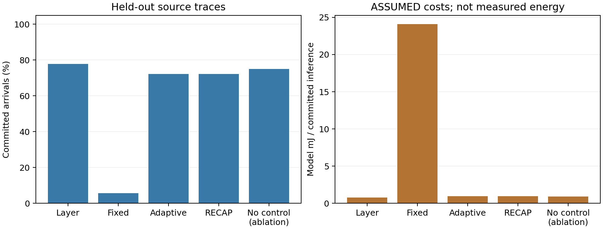

# G5 — Tích hợp mapper/runtime, KWS và đánh giá trên trace test

Ngày: **15/10/2026**. Trạng thái thực thi: **G5_HYBRID_SIMULATION_EXECUTED**.
Đã chạy pipeline toàn mạng và đánh giá test độc lập. **Chưa đạt mục tiêu lợi
ích nghiên cứu: RECAP không vượt baseline thích nghi mạnh trong cấu hình này.**
Các số joule/giây của hệ thống vẫn là mô hình giả định; chưa phải kết quả
năng lượng phần cứng, chưa đóng các thiếu sót G1 hoặc đủ bằng chứng nộp IEEE.

## 1. Kết quả chính đã chạy

| Hạng mục | Bằng chứng |
|---|---|
| KWS có nhãn | 1.000 MFCC INT8 từ EEMBC; model MLPerf Tiny đã ghim ở G2 |
| Accuracy reference | **901/1.000 = 90,1%**; không huấn luyện lại model |
| Đối chiếu đường tính toán riêng | 36 mẫu có nhãn, mỗi lớp trong mỗi split + 3 mẫu stress |
| Tensor correctness | **507 operator outputs, 2.813.928 phần tử, 0 mismatch** |
| Full-network recovery | **16 ca/16 lần mất nguồn**, output 12 byte khớp reference |
| Unit tests | **12 tests**, gồm **2.346 vị trí cắt theo ACK** của scratch/log/root |
| Đánh giá mapper/runtime | **108 lượt chạy**, 207 output đã commit được so đủ tensor |
| Held-out test | **12 trace × 3 arrivals = 36 input/method**, 5 methods/ablations |
| Algorithm SRAM bound | **14.016 B / 16.384 B**; chưa phải compiled runtime arena |
| NVM reservation | **207.228 B / 262.144 B**; log được tái sử dụng theo tầng |
| Admission | 0 depletion bên trong unit đã admission; retention wait có thể mất nguồn |

Nguồn kết quả: [summary](../10_Experiments/g5/summary.json),
[audit độc lập sau chạy](../10_Experiments/g5_audit/audit.json),
[manifest](../10_Experiments/manifests/g5_run.json).
Các con số 207 output là tổng train/validation/test của mọi method; không
phải 207 mẫu test độc lập. Fault campaign và 39 mẫu đối chiếu được ghi riêng.

## 2. Phạm vi KWS end-to-end

Runtime nhận feature INT8 49×10, tự tính first-conv, cả bốn cặp DW/PW,
pooling, reshape và classification head rồi commit output cuối. Mọi tầng
phụ thuộc vào dữ liệu đã tính/khôi phục thật; không đưa golden intermediates
vào làm kết quả thực thi.

Đây là **hybrid feature-to-output KWS simulation**. First-conv/DW/PW/pooling
dùng số nguyên. FC tích lũy integer nhưng requantize trên CPU theo float64
reference của TensorFlow 2.21; softmax dùng một TFLite operator độc lập nhận
logits đã tính. Không nhận đây là full accelerator RTL hoặc all-integer CPU
head. Audio capture/MFCC preprocessing và hàng đợi thu nhận cảm biến nằm
ngoài phạm vi; target NVM chỉ giữ feature hiện đang được phục vụ.

Lỗi được phát hiện và sửa trước tuning/test: dùng quy tắc requantization
DW/PW cho FC làm logit lớp 8 của `tst_000012_Go_1.bin` khác reference một đơn
vị, dù label cuối vẫn giống. Đã sửa CPU head theo dispatch/overload của
[TensorFlow 2.21 FC](https://github.com/tensorflow/tensorflow/blob/v2.21.0/tensorflow/lite/kernels/fully_connected.cc)
và [reference kernel](https://github.com/tensorflow/tensorflow/blob/v2.21.0/tensorflow/lite/kernels/internal/reference/integer_ops/fully_connected.h).
Head hiện đối chiếu đúng trên cả 1.000 input. Tensor checks 13 output/từng
mẫu giữ trường hợp regression này, không chỉ kiểm label.

Dataset lấy từ [EEMBC datasets/kws01](https://github.com/eembc/energyrunner/tree/cf7c2f2634608a7c0ea7458ab7cb3379f2863424/datasets/kws01),
commit `cf7c2f2634608a7c0ea7458ab7cb3379f2863424`, mỗi file đúng 490 B và có
SHA-256 trong [source manifest](../05_Model_Training/reference_eembc/source_manifest.json).
90,1% là accuracy của model có sẵn trên bộ 1.000 feature đó, không phải
cải thiện accuracy do RECAP hoặc chứng nhận MLPerf compliance.

## 3. Tách tuning/test và baseline mạnh

Protocol/cost/grid được lưu trước kết quả chính tại
[g5_protocol.json](../09_Simulation/configs/g5_protocol.json).
Train/validation/test dùng seed bases 191000/201000/211000, độc lập G3.
Mỗi family có 1/1/3 trace, gồm hai capacitor capacity 25/100 µJ và hai
harvest means giả định 0,5/2 mW. Horizon 4 s, arrivals 0/1,3/2,6 s;
deadline mỗi input cách arrival 1,3 s. Tất cả vẫn được quan sát tới horizon.

Input được nhóm theo hash feature, không chỉ tên file. Có một feature lặp
ở cả index 196 và 586; chuyển cả nhóm sang validation. Pool sau tách là
100 train / 101 validation / 799 test, tương ứng 100/100/794 hash duy nhất;
không có cùng feature bytes giữa các split. Các trace lấy input trong đúng
pool tương ứng, không dùng toàn bộ pool cho từng lần chạy.

- **B1_layer:** ghi output theo tile nhưng chỉ công nhận checkpoint tầng;
  mất nguồn trước root phải chạy lại tầng chưa hoàn tất.
- **B2_fixed:** 1 pixel/CO16/CI64, không lưu intermediate.
- **B3_adaptive:** chọn spatial/CO/CI/save flags theo thời gian dự kiến trên
  mỗi output, dựa vào năng lượng hiện tại. Không còn chỉ thích nghi CI như G3.
- **RECAP:** cùng candidate set, ưu tiên năng lượng dự kiến/output.

Cả B3 và RECAP đều được fit reserve fraction trong {0; 0,15; 0,30} trên
train/validation, với completion/on-time tolerance 5 **điểm phần trăm**.
Cả hai chọn **0,30**. Policy/code/model/splits/scenarios được khóa trong
[frozen_policy.json](../10_Experiments/g5/frozen_policy.json) lúc
09:09:39 UTC, trước khi chạy test. Không chỉnh policy/cost sau test.

## 4. Kết quả trên trace test

| Method | Commit / 36 | Completion | On-time / tất cả arrivals | Model mJ / commit |
|---|---:|---:|---:|---:|
| B1_layer | **28** | **77,78%** | **52,78%** | **0,7923** |
| B2_fixed | 2 | 5,56% | 0% | 24,0853 |
| B3_adaptive | 26 | 72,22% | 50,00% | 0,9623 |
| RECAP | 26 | 72,22% | 50,00% | 0,9623 |
| RECAP bỏ assumed control overhead — ablation | 27 | 75,00% | 52,78% | 0,9110 |



RECAP và B3 có cùng lựa chọn geometry, energy và completion timestamps
trong **12/12 trace**. Giảm năng lượng so B3 = **0%**; paired bootstrap
2.000 lần có CI95 **[0%; 0%]**, không có replicate undefined. Đây là tính
đồng nhất của hai policy trên các cấu hình đã chạy; không phải khẳng định
mọi workload/hardware đều như nhau. Mục tiêu 20% **không đạt**.

> **Note về sự khác biệt với G3 22,09% reduction:** G3 chạy trên microtile
> KWS cố định với DW energy ×30 debug, không gồm bank-transfer accounting,
> bank residency và event-driven waits mà G5 thêm vào. Cùng cost model G2
> với coefficient DW×30 nhưng score chọn trạng thái G5 có thêm bank-load
> cost nên RECAP và B3 thấy cùng một per-output cost. Trong G3, RECAP
> chọn `save_z=false, keep_ps=false` ở CI64, tức không tận dụng SAVE;
> ablation `no_weight_reuse` cho cùng kết quả cho thấy cải thiện 22,09%
> gắn với mapping/geometry chứ không phải weight residency. G5 thêm các
> chi phí bank-load/residency mới, RECAP và B3 trùng lựa chọn geometry và
> completion timestamps trong 12/12 trace, dẫn đến 0% reduction. Đây là
> lý do kỹ thuật khiến 22,09% G3 không bảo toàn khi đưa vào full KWS.

B1_layer còn có point estimate tốt hơn RECAP: nhiều hơn 2 commit và model
energy/commit thấp hơn. RECAP ít hơn 5,56 điểm phần trăm completion, vượt
tolerance 5 điểm nếu dùng B1 làm đối chứng. Không được chọn B2 yếu làm
đối chứng chính rồi tuyên bố RECAP thành công.

p95 latency của **mọi method đều vô hạn** vì tính cả input unfinished;
JSON lưu `null` + `p95_is_infinite=true`. Không kết luận latency không
suy giảm từ so sánh infinity với infinity.

Accuracy conditional trên số input commit của RECAP = 22/26 = 84,62%;
correct committed/arrival = 22/36 = 61,11%. Đây là metric dịch vụ trên
subset nhỏ được hoàn thành, không thay thế accuracy reference 901/1.000.

## 5. Tích hợp codec và overhead

Đã dùng header binary-v1 124 B từ G4 thay JSON G3; lưu PS dưới dạng INT32
little-endian, kiểm full identity/CRC, dùng hai scratch slots, immutable
layer logs và hai root slots để khôi phục graph. Graph protocol là phần
software mới; chưa có RTL chứng minh full-network transaction refinement.
Chi tiết tại [runtime spec](../03_Architecture/g5_runtime_spec.md).

Ledger tính weight/input/anchor transfers, actual checkpoint bytes, metadata,
log copy, root publication, boot/scratch scans, restore, CPU head, decisions,
controller cycles và retention wait. G4 commit equation được đưa vào cùng
byte service; thời gian bus không bị cộng hai lần. Cân bằng capacitor/ledger
được assert trên mọi lượt chạy. Marker/persistence vẫn là giả định backend.

Trên RECAP test, **assumed control + decision/parser energy = 2,56%** tổng
consumed energy; **nhóm `checkpoint_path` của script = 28,21%**. Nhóm sau gồm
checkpoint/log/root, scan destination và read root/scratch; chưa gồm toàn bộ
boot, `restore_source` và `load_next_anchor`, nên không coi là tổng mọi chi
phí phục hồi. Hai phép phân loại có phần giao nhau, không cộng thành tổng
overhead. Các hệ số
controller, parser, hash/decision và CPU head là ngân sách giả định, chưa
được hiệu chuẩn theo instruction trace hoặc physical implementation.

Ablation bỏ control giữ nguyên metadata/traffic và policy đã khóa, nhưng
thay đổi cả giả định energy/time nên lịch thực thi cũng đổi: 27 thay vì
26 commit; energy/commit giảm 5,33%. Không diễn giải 5,33% là phép đo công
suất controller hoặc phần trăm chỉ do một thành phần phần cứng.

Audit có thêm profile Python tạo candidate trên máy hiện tại, 100 samples
sau warm-up; median/p95 được lưu ở `host_profile` trong audit JSON và thay
đổi theo mỗi lần đo. Đây là host timing, khác assumed decision budget 10 µs
của target model; không dùng host timing
để thay đổi cấu hình sau khi xem test. Việc port/đo decision cost thực còn
thiếu và có thể làm thay đổi kết quả.

## 6. Correctness, recovery và giới hạn

12 tests kiểm torn publication, giữ old/new generation, identity/CRC, source
integrity, stale input, cùng feature ở hai arrival khác nhau, zero harvest,
causality và undefined-bootstrap handling. 2.346 ACK boundaries không đồng
nghĩa exhaustive fault proof của toàn graph.

16 ca full-network dùng CI16 + SAVE_DW + KEEP_PS; ngắt trước/giữa/sát ACK/
sau ACK của partial/output/log/root publication, discard volatile state,
boot từ bytes NVM và chạy hết model. Mọi output khớp reference; external
diagnostic discharge được tính trong ledger. Main test có 4 loss của RECAP
do retention wait, nhưng không depletion trong work unit đã admission.

SRAM là bound cho buffer thuật toán; chưa có compiled stack, TFLite Micro
arena hoặc full accelerator memory mapping. Weight bank 2 KiB được mô hình
như vùng streaming; chi phí load là hệ số gộp giả định, chưa có macro bank
programming riêng hoặc weight-residency benefit. Phần cứng, real harvested
traces và calibrated energy vẫn chưa được xác nhận.

## 7. Quyết định nghiên cứu sau G5

**Pipeline G5 đã thực thi; giả thuyết lợi ích hiện tại chưa được chứng minh.**
Hai heuristic energy/time cho cùng quyết định trong cost profile này;
SAVE_DW/KEEP_PS không được chọn ở main held-out test, dù đã kiểm chức năng
trong fault campaign. B1_layer tốt hơn cho thấy per-tile durability/copy
overhead cần được xét như một biến tối ưu thực sự. Kết quả G3 22,09% không
được chuyển thành claim full KWS hoặc claim năng lượng G5.

Hướng kế tiếp cần kiểm tra là **chọn độ hạt durability**: khi nào giữ kết quả
tạm trong log, khi nào publish tile/stage root và khi nào lưu DW/PS, dựa vào
chi phí redo và năng lượng hiện tại. Phải so với cả B1 và B3 có cùng primitive,
kiểm runtime overhead có căn cứ, và giải quyết novelty/calibration còn thiếu
ở G1. Đây là đề xuất cho protocol tiếp theo, chưa phải thuật toán/kết quả mới.
Nếu sửa thuật toán hoặc fit thêm chi phí, 12 trace G5 này trở thành dữ liệu
chẩn đoán; cần holdout seed/input groups mới trước claim tiếp theo.

## 8. Tái lập và tài liệu

```powershell
python 10_Experiments/setup_g5_data.py
python 10_Experiments/run_g5.py
python 10_Experiments/audit_g5.py
```

Setup cần network ở máy chưa có dataset; các lần sau kiểm hashes local.
Main run kiểm manifests G2/G3/G4, không chạy lại RTL campaigns. Đợt đã chạy
mất khoảng 118 s; thời gian máy khác có thể khác. Main run ghi đè generated
G5 artifacts, fit lại trên cùng train/validation rồi đánh giá cùng test với
source đã khóa. Không dùng việc rerun để chọn policy dựa trên test.

[Hướng dẫn chung](../10_Experiments/reproduce.md),
[raw results](../10_Experiments/g5/raw/test.jsonl),
[accuracy/confusion matrix](../10_Experiments/g5/accuracy.json),
[fault results](../10_Experiments/g5/faults.json),
[runtime spec](../03_Architecture/g5_runtime_spec.md).
