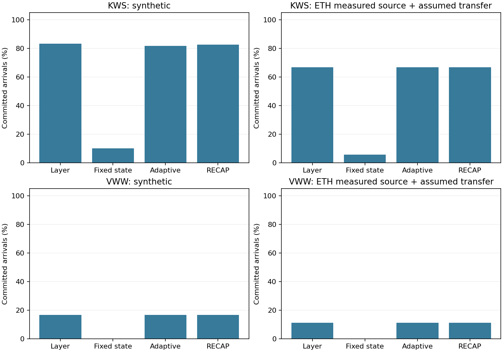
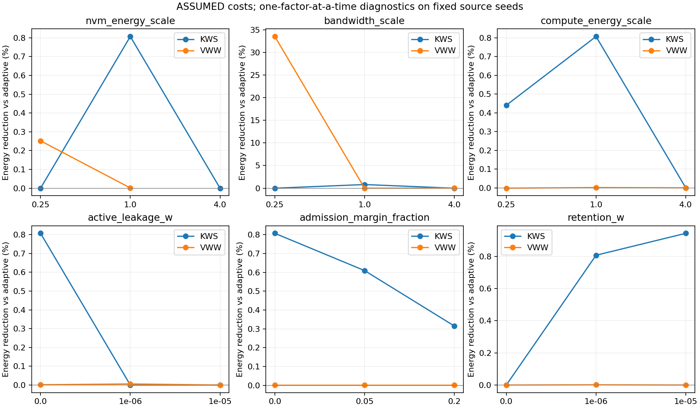

# G6 — Hai workload, trace đo thực, sensitivity và ablation

Ngày: **15/10/2026**. Trạng thái: **G6_MULTIPLE_WORKLOAD_SIMULATION_EXECUTED**.
Đã chạy đầy đủ ma trận thí nghiệm khai báo của G6, gồm hai mạng, trace ETH,
sáu trục sensitivity và mười ablation/workload. **Mục tiêu giảm 20% trên đánh
giá chính vẫn chưa đạt.** Mapper hiện tại còn thiếu lợi ích expected redo
trong score chọn trạng thái; chưa thể nhận là thuật toán RECAP đầy đủ đã
được chứng minh hoặc bài IEEE đã sẵn sàng nộp.

## 1. Những gì đã thực thi

| Hạng mục | Kết quả |
|---|---|
| Workload | KWS DS-CNN và VWW MobileNet INT8, cùng commit MLCommons đã ghim |
| Configurations riêng biệt | **1.216 case artifacts**; 1.360 hàng trong các ma trận do tái sử dụng baseline/default cells |
| Main evaluation | 448 lượt: 2 workload × 4 methods × 56 source/capacitor cases |
| Main committed outputs | **481**, so đầy đủ INT8 output với reference sau commit |
| Source cases / workload-method | 40 stochastic + 2 steady + 2 zero + 12 measured-derived |
| Ablation | **10/workload**, 240 hàng, mỗi intervention có cùng 12 source cases |
| Sensitivity | **6 trục × 3 mức × 2 workload × 2 methods × 8 traces = 576 hàng** |
| Backend × policy | 96 hàng, gồm cả hai workload và hai cost profiles |
| Correctness | **14 unit tests**, 16 mẫu kiểm arithmetic / 280 operator outputs / **1.794.096 phần tử**, 0 mismatch |
| Full-network faults | **8 ca / 8 loss**, khôi phục đúng cả KWS và VWW |
| Random large-slot faults | **1.000 schedules**, 2.494 loss và 4.158.674 byte writes thực thi; 0 mismatch |
| Logical SRAM highwater | **41.216 B**, trong budget mở rộng 65.536 B |
| NVM highwater, gồm all-live ablation | **1.158.122 B**, trong budget mở rộng 2.097.152 B |
| Admission | 0 depletion bên trong admitted unit; retention brownout được tính riêng |

[Summary](../10_Experiments/g6/summary.json),
[main results](../10_Experiments/g6/results.json),
[audit](../10_Experiments/g6_audit/audit.json),
[manifest](../10_Experiments/manifests/g6_run.json).
1.000 random schedules là kiểm checkpoint DW/PW lớn từ tensor model thật,
gồm CI256; **không phải 1.000 lần chạy toàn mạng**. Tám full-network fault
cases được ghi riêng. Đây là finite simulation evidence, không phải formal proof.

## 2. Workload thứ hai và bộ nhớ

VWW dùng nguyên model `vww_96_int8.tflite` **333.288 B**, SHA-256
`597a384c8c2c8a1276f04702f25013b7838f2f814f1ca7c174d295b73e3d6b7b`.
Nguồn: [MLCommons Tiny, commit 4addd0f](https://github.com/mlcommons/tiny/tree/4addd0fa08d216e20637637874e084895f289da4/benchmark/training/visual_wake_words).
VWW có 13 cặp DW/PW, stride 1/2, CI tới 256; KWS có bốn cặp CI64.

**VWW không vừa cấu hình gốc 16 KiB SRAM / 256 KiB NVM:** model đã vượt NVM,
anchor lớn nhất 36.864 B vượt SRAM. Không thu nhỏ model hoặc ghi nhận cấu hình
này đã chạy được. G6 dùng **cùng budget giả định 64 KiB SRAM / 2 MiB NVM cho
cả hai workload và mọi method**. Minimal VWW layout dùng 1.027.050 B NVM;
all-live reserve thêm hai slots. Xem
[memory feasibility](../10_Experiments/g6/memory_feasibility.json).

First-conv/DW/PW được tính bằng integer kernels riêng; CPU head tách biệt nhận
activation đã tính và chạy pool/reshape/FC/softmax reference. Không đưa golden
intermediate vào runtime. Đây là hybrid input-to-output simulation; chưa có
full VWW accelerator RTL hoặc compiled CPU/TFLite arena trong 64 KiB.
Capture/preprocessing và input queue ngoài thiết bị không nằm trong tử số năng lượng.

Dataset VWW gồm 40 ảnh COCO thật, 20 ảnh/lớp theo thứ tự label file MLCommons
đã ghim; JPEG/feature đều có hashes. Dùng RGB bilinear resize 96×96 và
`uint8-128`, gắn nhãn **research preprocessing**, không nhận là official
MLPerf performance inputs. Accuracy reference **33/40 = 82,5%** chỉ áp dụng
subset nhỏ này. Bốn ảnh dành cho diagnostics; 36 ảnh còn lại làm input pool.
KWS dùng pool 752 feature loại các hash đã dùng trong G5 runtime/checks.
Không huấn luyện lại model và không dùng nhãn để fit mapper.

## 3. Trace nguồn thực và khóa protocol

Đã tải đúng member `pos16_power_relative.h5` **179.789.688 B** bằng HTTP Range,
không tải archive 32 GB. **SHA-256 toàn member khớp checksum công bố**.
Nguồn [ETH indoor solar, Zenodo 3715472](https://zenodo.org/records/3715472),
Lukas Sigrist, Andres Gomez, Lothar Thiele; DATA 2019; CC BY 4.0.

Sáu cửa sổ 120 s được chọn bằng index cách đều, không chọn theo performance.
Giữ nguyên timestamps khoảng 1,00352 s/mẫu, không nén thời gian hoặc chuẩn hóa
biên độ. Dùng đúng dấu từ notebook tác giả: `P_in = -I_in*V_in`.
Nguồn đưa vào tụ là `max(0,P_in)*0,70`; **70% là giả định conversion**, không
phải công suất rail của project đã đo. Chỉ có một vị trí đo; fixed-MPPT/
virtual-battery measurement chưa xác minh đáp ứng harvester với tụ tải thay đổi.

[Window metadata/raw extracts](../10_Experiments/g6/eth_windows.json),
[source manifest](../09_Simulation/traces/g6_eth/source_manifest.json).
Độ phân giải khoảng một giây không xác nhận các biến động nguồn nhanh hơn.

Nguồn tổng hợp có 10 seed độc lập cho mỗi mild/severe × capacitor family,
tổng 40 trace; steady/zero là các điều kiện xác định, không tạo CI từ các
replica nguồn giống nhau. Capacity 25/100 µJ; horizon 8 s; ba arrivals
0/2,6/5,2 s, deadline interval 2,6 s. Hệ số on-state 2 mW; mild có 20% đoạn
zero, severe 80%, nên hai nhóm cũng khác average supplied energy.
Trace ETH dùng horizon 120 s, arrivals 0/40/80 s, deadline interval 40 s.

Reserve 0,30 của cả RECAP và B3 được chuyển nguyên từ G5 train/validation;
không fit trên G6 hoặc điều chỉnh riêng để VWW thắng. Code, model, source,
input pools và toàn bộ ma trận đã khóa trước main evaluation trong
[frozen protocol](../10_Experiments/g6/frozen_protocol.json).
Audit xác nhận không dùng lại power seeds hoặc feature hashes của G5 runtime.

## 4. Kết quả chính — chưa đạt mục tiêu 20%

**Nguồn tổng hợp gián đoạn: 40 trace, 120 arrivals/method/workload.**
Mọi năng lượng trong bảng là **model energy với hệ số giả định**.

| Workload | Method | Commit / 120 | Model mJ / commit | Đúng hạn / tất cả arrivals |
|---|---|---:|---:|---:|
| KWS | B1_layer | **100** | **0,8782** | **75,83%** |
| KWS | B3_adaptive | 98 | 0,9844 | 72,50% |
| KWS | RECAP | 99 | 0,9709 | 73,33% |
| VWW | B1_layer | 20 | 15,0868 | 0% |
| VWW | B3_adaptive | 20 | 15,0878 | 0% |
| VWW | RECAP | 20 | 15,0878 | 0% |

KWS giảm **1,368%** energy/commit so B3; CI95 paired bootstrap 2.000 lần
**[0,126%; 3,504%]**. Completion/on-time difference CI **[0; 2,5] điểm phần
trăm**. Đây là lợi ích nhỏ trong cost model đã khai báo, chưa đạt 20%.
VWW giảm khoảng **0,000020%**; CI95 **[−0,00418%; 0,00377%]**, thực tế gần 0.
Không dùng các chênh lệch rất nhỏ làm bằng chứng lợi ích vật lý.

B2 fixed-state chỉ đạt 12/120 KWS và 0/120 VWW. B1 và B3 vẫn là đối chứng
chính; không chọn B2 yếu để kết luận RECAP thành công. B2 G6 dùng CO16/CI16
và lưu DW/PS, khác B2 output-only G5. G6 cũng thêm bank-transfer accounting,
bank residency và event-driven waits, nên bảng energy G5–G6 không phải thí
nghiệm before/after chỉ thay workload.

**Trace đo thực → rail giả định: sáu ngày × hai capacities, 36 arrivals/method.**

| Workload | B1 commit | B3 commit | RECAP commit | RECAP model mJ/commit | Giảm so B3 |
|---|---:|---:|---:|---:|---:|
| KWS | 24/36 | 24/36 | 24/36 | 0,9569 | 0,0425% |
| VWW | 4/36 | 4/36 | 4/36 | 16,8884 | ≈0% |

Bootstrap giữ cả hai capacities và mọi arrival trong cùng measurement-day
block. Có **3/2.000** energy replicates undefined ở KWS và **178/2.000** ở
VWW; unconditional energy CI được giữ **null**, không loại replicate để
tạo khoảng tin cậy đẹp. Chỉ sáu measurement days của một vị trí đo.



p95 latency trên tập stochastic và measured của các method không hữu hạn
khi tính cả unfinished inputs. VWW không đạt deadline của bất kỳ input
completed nào trong các tập này. Với zero source, mọi method không hoàn
thành và energy/commit undefined. Steady KWS có 6/6 completion ở B1/B3/RECAP;
không gộp điều kiện này vào tuyên bố p95 vô hạn của tập intermittent.

> **Note về VWW commit 20/120 nhưng on-time 0%:** Tổng 20 commit của VWW
> đến từ **stochastic/measured tập hợp nhất**, không phải từ arrival nào
> duy nhất. Mỗi input completed vượt quá `arrival + deadline_interval` của
> riêng nó (deadline interval VWW = 2,6 s, horizon 8 s, ba arrivals
> 0/2,6/5,2 s) nên **không input nào on-time tuyệt đối**. VWW tốn nhiều
> năng lượng hơn KWS (anchor 36.864 B vượt SRAM gốc, 13 cặp DW/PW với
> CI tới 256) nên nhiều arrival mất nguồn trước khi hoàn tất; các commit
> còn lại đến từ những arrival có nguồn tốt nhưng vẫn trễ deadline. Đây
> là hiệu ứng của deadline interval 2,6 s kết hợp supplied energy
> thấp-trung bình của measurement day, không phải lỗi ledger/commit.
> Không gộp "commit khác 0" thành "on-time thấp" hay ngược lại.

## 5. Toàn bộ các trục ablation đã khai báo

Mỗi variant có 12 source cases cố định, **36 arrivals/workload**. Full RECAP
trên subset này đạt KWS 26/36 và VWW 6/36. Thay đổi dưới đây là energy/commit
của **ablation so với full**, không phải improvement so B3; dấu `+` nghĩa đắt hơn.

| Intervention | KWS | VWW |
|---|---|---|
| Ignore reload trong decision; execution vẫn tính đủ | 26/36; ≈0% | 6/36; ≈0% |
| Always SAVE_DW, PS vẫn chọn riêng | 26/36; **+9,60%** | 6/36; +0,00462% |
| Always REPLAY_DW | 26/36; ≈0% | 6/36; ≈0% |
| Fixed mapping + recovery choice | **8/36** | **0/36**, energy/commit undefined |
| Adaptive mapping + fixed recovery | 26/36; ≈0% | 6/36; ≈0% |
| Continuous-power fused mapping cố định | 26/36; −0,239% | 6/36; ≈0% |
| Unfused DW/PW graph | **25/36; +21,18%** | 6/36; +0,00557% |
| Conservative all-live buffer copy | **10/36** | **0/36**, energy/commit undefined |
| No weight residency | 26/36; ≈0% | 6/36; −0,00748% |
| No assumed control/decision overhead | 26/36; −2,246% | 6/36; −0,02235% |

Hai intervention mapping/recovery tách riêng từng trục; fusion có cả fixed
continuous mapping và graph DW/PW không fusion. Tuy nhiên đây **chưa phải
thuật toán tự chọn fusion graph theo từng pair**. Không gọi ablation là
reproduction chính xác của Chime/Viadotto hoặc thay thế baseline B4 còn thiếu.

`all_live` thực sự ghi thêm bản COW các algorithm buffers/bank vào slots đã
reserve, bên cạnh minimal record. Giữ objective mapper cũ, không reoptimize
cho snapshot lớn hơn. Có năm case/workload bị chặn vì **snapshot được chọn**
không vừa tụ; đây không chứng minh mọi mapping full-state đều infeasible.
Không nhận đã checkpoint toàn bộ CPU stack/registers.

## 6. Sensitivity và backend × policy

Đã chạy đủ sáu trục OFAT: NVM energy ×0,25/1/4; bandwidth ×0,25/1/4;
compute energy ×0,25/1/4; active leakage 0/1/10 µW; admission margin
0/5/20%; retention 0/1/10 µW. Dùng cố định hai seed đầu của mỗi stochastic
family, tổng 8 trace; không chọn lại seed hoặc fit policy sau khi xem kết quả.



Các khoảng này là **engineering stress ranges**, không phải confidence
intervals lấy từ macro/PDK. KWS không xuất hiện lợi ích 20% trong sweep này.
VWW bandwidth ×0,25 có point reduction **33,51%**, nhưng chỉ có **3 so với 2
completion trên 24 arrivals**. Đây là cell sparse của sensitivity, không phải
kết quả chính đạt mục tiêu hoặc lợi ích đã xác nhận bằng CI. Không chọn riêng
cell này làm headline. Với NVM energy ×4, cả hai policy VWW không hoàn thành;
energy ratio undefined, được giữ nguyên trong JSON/đồ thị như một điểm thiếu.

Đủ bốn cấu hình backend × policy được chạy trên hai workload. Digital
surrogate chỉ đổi hệ số PW energy ×10 và time ×4, giữ backend traffic chung;
chưa phải conventional digital hardware đã được hiệu chuẩn. Các chênh lệch
nhỏ không đủ chứng minh lợi ích đặc thù SRAM-CIM.

## 7. Vì sao thua hoặc không cải thiện?

**Checkpoint hai bản gây chi phí thực trong mô hình.** Trên steady KWS,
B1 và RECAP đều hoàn thành 6/6. Tổng RECAP 5,44354 mJ, B1 4,75903 mJ;
chênh 0,68451 mJ. Scratch publication của RECAP là 0,66921 mJ, tương đương
**97,76% chênh lệch đó**. Output hiện được publish vào scratch rồi copy sang
layer log. Đây là nguyên nhân kỹ thuật cần kiểm tra trước khi quy mọi phần
thua cho bản chất tile checkpoint hoặc SRAM-CIM.

**Score chọn trạng thái chưa có expected redo credit.** Trong main, RECAP
không chọn SAVE_DW hoặc KEEP_PS trên cả hai workload. Diagnostic sau chạy
so cùng geometry/CI có **48/48 cặp KWS và 126/126 cặp VWW** mà lưu trạng thái
luôn đắt hơn trong nominal per-job objective. Score tính chi phí thêm của save
nhưng chưa ghi nhận lợi ích giảm redo khi phải chờ/khởi động lại. Do đó chưa
thể nhận đã chứng minh joint SAVE/REPLAY optimization hoặc kết luận SAVE vô ích.

**VWW bị giới hạn bởi supplied energy trong horizon.** RECAP tiêu thụ khoảng
**99,96%** ngân sách rail supply + initial capacitor ở cả stochastic lẫn
measured-derived domains. Nhiều thay đổi overhead không làm vượt thêm một
completion trước horizon, nên ratio gần như giữ nguyên. Đây là diagnostic
ngân sách nguồn, không đổi tử số energy/commit thành harvested energy.

[Post-hoc mechanism analysis](../10_Experiments/g6_analysis/analysis.json)
ghi rõ không fit policy hoặc chạy lại held-out inference. Raw summary giữ
98 negative comparison records, gồm cả dấu âm ở mức floating point. File
[loss cases](../10_Experiments/g6_analysis/material_loss_cases.json) lọc số
học để rà soát, không coi đó là kiểm định ý nghĩa thống kê hay thay success criterion.

## 8. Quyết định trước giai đoạn viết bài

**G6 đã thực thi như một nghiên cứu mô phỏng đa workload; claim lợi ích chính
chưa đạt.** Bước tiếp theo cần thực hiện trước khi nhận thuật toán hoàn thiện:

1. Bổ sung marginal redo cost vào objective từ thông tin quá khứ/hiện tại.
   Rủi ro phải đặt đúng ở retention/recovery; admitted unit không được giả
   định có depletion tùy tiện. Expected cost chỉ dùng để chọn policy; ledger
   vẫn chỉ tính redo thực tế, không cộng expected recovery lần nữa.
2. Đánh giá publish trực tiếp vào durable output log và lựa chọn độ hạt
   tile/stage, với cùng primitive cho B1/B3/RECAP; kiểm lại protocol/RTL.
3. Chốt literature baseline B4, novelty và calibration G1. Full-network
   RTL/CI256, compiled runtime footprint và physical NVM atomicity vẫn thiếu.
4. Khi thay thuật toán/cost, dùng seed mới và measurement windows/input
   groups mới. Dữ liệu G6 đã xem chỉ còn dùng development/diagnostic.

Giữ `ready_for_energy_results=false`. Chưa chuyển số mô hình thành silicon
energy, TOPS/W, area/fmax, hoặc cam kết bài IEEE được chấp nhận.

## 9. Tái lập

```powershell
python 10_Experiments/setup_g6_sources.py
python 10_Experiments/run_g6.py
python 10_Experiments/audit_g6.py
python 10_Experiments/analyze_g6.py
```

Setup cần network khi chưa có sources; sau đó kiểm hashes local. Run chính
có thể chạy tuần tự độc lập. Đợt đã thực hiện mất khoảng **25 phút**, có hai
CPU workers gọi cùng frozen runtime và publish cache JSON nguyên tử. Main
thực thi 688 cases, workers 528; tổng 1.216 case files. Các lần chạy lại tái
sử dụng cache có source binding; không cần lặp G4 RTL campaigns.

[Runtime/evaluation spec](../03_Architecture/g6_evaluation_spec.md),
[reproduce guide](../10_Experiments/reproduce.md),
[raw main](../10_Experiments/g6/raw/main.jsonl),
[raw ablations](../10_Experiments/g6/raw/ablations.jsonl),
[raw sensitivity](../10_Experiments/g6/raw/sensitivity.jsonl).
