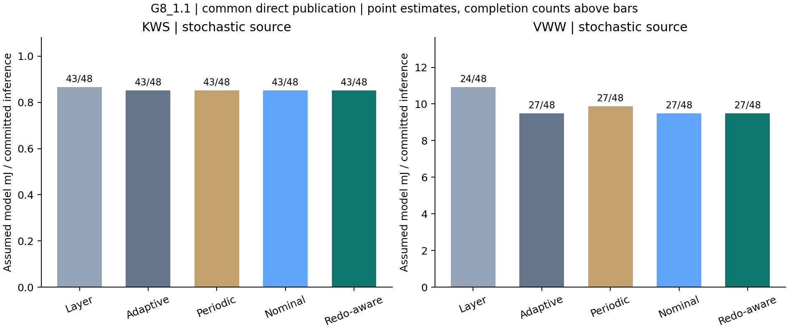

# G8 — Bản hoàn thiện kỹ thuật trên máy tính

Ngày: **23/10/2026**. Đợt hợp lệ: **G8_1.1 / 20261023-v2**;
RTL: **rtl-20261023-v3**. G2–G6 và manifest gốc được giữ nguyên.

## Mức hoàn thiện

**80/100 theo rubric công việc kỹ thuật được khai báo bên dưới.** Đây là
cách quản lý phạm vi: tám nhóm engineering đã có artifact kiểm tra được,
hai nhóm scientific/physical validation còn mở. Không diễn giải thành đã
chế tạo 80% chip, hoàn tất 80% tính mới hoặc sẵn sàng nộp bài.

| Nhóm công việc | Điểm | Trạng thái |
|---|---:|---|
| Phạm vi và tài liệu hiện hành | 10 | Đạt |
| Arithmetic/reference | 10 | Đạt trong phạm vi kiểm tra |
| Durability và fault tests | 10 | Đạt hữu hạn, không phải formal proof |
| Ranking expected-redo và oracle độc lập | 10 | Đã hiện thực; chưa chứng minh lợi ích toàn mạng |
| Direct publication và publisher RTL | 10 | Đã kiểm trên máy |
| Năm control cùng backend/publication | 10 | Đạt; B4 chưa phải prior-art reproduction |
| Protocol freeze, raw results và stress cases | 10 | Đạt; công khai đợt tích hợp bị hủy |
| Lệnh tái lập và audit độc lập | 10 | Đạt trên workspace hiện tại |
| Đóng góp khoa học, đối chứng tối ưu gần nhất, review độc lập | 10 | Còn mở |
| Backend có căn cứ/calibration và xác minh triển khai thực | 10 | Còn mở |

Chi tiết máy đọc: [software_readiness.json](../10_Experiments/g8/quality_20261023/software_readiness.json).

## Những gì đã sửa và thêm

- Thêm `g8_runtime.py`: ranking expected-redo bằng mô hình renewal hữu hạn.
  Expectation chỉ tác động quyết định, không được cộng vào execution ledger.
- Bỏ scratch-output mặc định. Tất cả policy dùng cùng durable layer-log path.
- Thêm rail disconnect tại absolute timestamps chung cho mọi policy; giữ
  charge bị xả khỏi load-energy numerator và kiểm conservation.
- Thêm B4 periodic có interval chọn từ development. Đây là control nội bộ;
  không gọi là thuật toán Chime tối ưu hoặc CIM-Tuner đã được reproduce.
- Thêm 24 ảnh VWW khác G6, bốn development và hai mươi holdout; tách feature
  dùng trong runtime G5/G6 và khóa source/input/protocol trước main.
- Sửa B1 geometry cho VWW CO128/256 và thêm kiểm tra mọi stage. Đợt G8_1.0
  ban đầu bị hủy, không dùng làm bằng chứng. G8_1.1 dùng seed nguồn/reset mới;
  pool feature đã xuất hiện trong đợt tích hợp lỗi nên không nhận là chưa từng chạy.
- Thêm publisher RTL streaming, testbench, generic synthesis, audit độc lập,
  lệnh test chung và hướng dẫn phần cứng cho tình huống không có lab.
- Chuyển README/Makefile/hướng dẫn cũ vào `docs/legacy`, bỏ số 8×/tape-out
  chưa xác minh khỏi trang hiện hành; thêm `.gitignore` và khởi tạo Git cục bộ.
  Chưa tạo commit hoặc remote; cần chọn metadata và tạo snapshot sau review.

## Kiểm chứng đã thực thi

| Kiểm tra | Kết quả |
|---|---|
| Python G2/G3/G4/G5/G6/G8 | **89 tests đạt**: 22 + 17 + 10 + 12 + 14 + 14 |
| Legacy G2–G6 | **2.769 mục SHA-256 khớp** |
| G8 main | **280 hàng**, 28 scenarios × 5 policy × 2 workload |
| G8 secondary | **120 hàng**, năm intervention trên subset preset |
| Output đã commit trong main | **642**, đều so với reference |
| G8 independent aggregate audit | **40 ô tổng hợp khớp** |
| Arithmetic development | **304.220 phần tử**, 0 mismatch trên hai input; không phải toàn dataset |
| Directed graph faults | **6 ca full-network**, hai workload × ba điểm cắt |
| Publisher RTL | **284 ACK-cut/stall cases**, hai invalid-command tests |
| Yosys publisher | Generic proc/opt/check đạt; **66 generic cells**, không phải LUT/area/PPA |
| Scratch-output writes trong main | **0** |

Audit: [integrity_audit.json](../10_Experiments/g8/quality_20261023/integrity_audit.json).
RTL: [rtl_report.json](../10_Experiments/g8/rtl-20261023-v3/rtl_report.json).
Các chiến dịch fault/RTL G2–G6 cũ được kiểm hash, chưa chạy lại toàn bộ trong G8.

## Kết quả chính — vẫn dùng cost giả định

Horizon G8 là 24 s, arrivals 0/8/16 s; khác protocol G6. Mọi số năng lượng
dưới đây là **model mJ/commit**, không phải số đo phần cứng.

| Workload | Miền nguồn | Policy | Hoàn thành | Model mJ/commit |
|---|---|---|---:|---:|
| KWS | stochastic | B1_layer | 43/48 | 0.865624 |
| KWS | stochastic | B3_adaptive | 43/48 | 0.851467 |
| KWS | stochastic | B4_periodic | 43/48 | 0.851821 |
| KWS | stochastic | RECAP_nominal | 43/48 | 0.851467 |
| KWS | stochastic | RECAP_redo | 43/48 | 0.851467 |
| KWS | external_reset | B1_layer | 24/24 | 0.874254 |
| KWS | external_reset | B3_adaptive | 24/24 | 0.815115 |
| KWS | external_reset | B4_periodic | 24/24 | 0.815115 |
| KWS | external_reset | RECAP_nominal | 24/24 | 0.815115 |
| KWS | external_reset | RECAP_redo | 24/24 | 0.815115 |
| VWW | stochastic | B1_layer | 24/48 | 10.911639 |
| VWW | stochastic | B3_adaptive | 27/48 | 9.496069 |
| VWW | stochastic | B4_periodic | 27/48 | 9.867436 |
| VWW | stochastic | RECAP_nominal | 27/48 | 9.496069 |
| VWW | stochastic | RECAP_redo | 27/48 | 9.496069 |
| VWW | external_reset | B1_layer | 19/24 | 16.514819 |
| VWW | external_reset | B3_adaptive | 24/24 | 8.742113 |
| VWW | external_reset | B4_periodic | 24/24 | 9.155634 |
| VWW | external_reset | RECAP_nominal | 24/24 | 8.742113 |
| VWW | external_reset | RECAP_redo | 24/24 | 8.742113 |

**RECAP_redo và RECAP_nominal không tạo thêm lợi ích so B3 trong tập chính.**
Chênh lệch VWW cỡ 1e-13 tương đối là nhiễu số, không diễn giải là cải thiện
hay suy giảm có ý nghĩa vật lý. Main chọn SAVE_DW = **0** và
KEEP_PS = **0**. Test crossover chứng minh ranking có thể
chọn state trong mô hình, chưa chứng minh state-saving hữu ích ở miền chính.
Mục tiêu lợi ích chính 20% so đối chứng thích nghi **chưa đạt**.

Khoảng tin cậy so từng control (paired bootstrap 2.000 lần; ít replicate
độc lập trong mỗi family nên giới hạn tổng quát hóa còn lớn):

| Workload | Miền | RECAP_redo so với | Giảm model energy/commit | CI95 |
|---|---|---|---:|---|
| KWS | stochastic | B1_layer | 1.635% | [0.374%; 3.067%] |
| KWS | stochastic | B3_adaptive | 0.000% | [0.000%; 0.000%] |
| KWS | stochastic | B4_periodic | 0.041% | [0.013%; 0.084%] |
| KWS | external_reset | B1_layer | 6.764% | [2.364%; 10.696%] |
| KWS | external_reset | B3_adaptive | 0.000% | [0.000%; 0.000%] |
| KWS | external_reset | B4_periodic | 0.000% | [0.000%; 0.000%] |
| VWW | stochastic | B1_layer | 12.973% | [5.370%; 21.410%] |
| VWW | stochastic | B3_adaptive | -0.000% | [-0.000%; -0.000%] |
| VWW | stochastic | B4_periodic | 3.764% | [3.583%; 3.999%] |
| VWW | external_reset | B1_layer | 47.065% | [43.852%; 50.224%] |
| VWW | external_reset | B3_adaptive | -0.000% | [-0.000%; 0.000%] |
| VWW | external_reset | B4_periodic | 4.517% | [4.345%; 4.668%] |

Không dùng lợi ích so B1 ở miền reset để thay thế phép so với B3 mạnh hơn.
Các ca chưa hoàn thành, zero source, energy undefined và p95 vô hạn được
giữ trong JSON. Đây là một đợt cùng host, không phải clean-host replay.

## Lợi ích của bỏ scratch-output — đánh giá phụ preset

So cùng policy và cùng sáu source cases đã khai báo, gồm steady và reset;
không trộn kết quả này với tập chính hoặc tuyên bố nó đạt mục tiêu 20%.

| Workload | Direct hoàn thành | Có scratch: model mJ/commit | Direct: model mJ/commit | Giảm |
|---|---:|---:|---:|---:|
| KWS | 18/18 | 0.924749 | 0.804470 | 13.007% |
| VWW | 18/18 | 9.253748 | 8.553874 | 7.563% |

Đây là can thiệp lên đường publication và chi phí planner có thể phản ứng
theo đường đó. Kết quả có ý nghĩa trong model, chưa là tiết kiệm vật lý đo được.

## Bạn nên làm tiếp trên máy tính

1. Tự chạy `run_tests.py` và `check_project.py`; sau đó chạy một G8 run-id mới.
   Giải thích được marker, CRC, PS frontier và energy ledger trước khi bảo vệ.
2. Làm baseline tối ưu gần prior art, không chỉ control periodic; đối chiếu
   đầy đủ state/action/objective. Có thể nhờ giảng viên review từ xa, không cần lab.
3. Cải thiện mô hình expected-redo: outage trong operation, thời gian chờ
   recharge, cold weight reload và boot scan. G8 dùng approximation boundary;
   phải khóa protocol/holdout mới trước khi kiểm các thay đổi này.
4. Dùng thêm trace/data độc lập, xem completion/on-time cùng energy; không
   chỉnh cost giả định để tạo thắng lợi. Lợi ích so B3 vẫn là việc chưa giải quyết.
5. Dựng bootstrap từ checkout sạch hoặc một máy khác. Hiện vẫn cần prior
   artifacts/reference inputs; chưa có clean-host một lệnh đã xác minh.
6. Tạo commit cục bộ với metadata bạn chọn, tách code/evidence được phép chia
   sẻ khỏi dữ liệu có quyền riêng; chưa có public release/DOI.

## Bạn cần làm gì trên phần cứng?

**Hiện chưa cần mua board:** bạn đã xác nhận không có quyền tiếp cận lab.
Mô phỏng + RTL trên máy là phạm vi làm được ngay. Phần chưa thể nghiệm thu
là calibration, physical persistence và triển khai thật, phải giữ là giới hạn.

Nếu sau này hợp tác được với lab: chốt board/macro/NVM; thêm SPI/persistence
adapter; map/synthesize và đo runtime SRAM; power-cycle trong khi ghi; ghi
V(t), I(t) cùng event markers; điền cost profile; so mọi policy trên cùng
input/nguồn/deadline. FPGA logic/RAM không tự chứng minh năng lượng SRAM-CIM.
Xem [lộ trình chi tiết](../06_FPGA/HARDWARE_ROADMAP.md) và
[template calibration](../10_Experiments/calibration_template.json).

## Điều kiện chưa được phép bỏ qua

Chưa chọn macro/calibrate NVM/control, chưa có toàn mạng RTL, compiled CPU
arena, đo năng lượng, formal proof, đối chứng tối ưu gần nhất hoặc independent
human scientific review. Bản thảo G7 vẫn là bản lịch sử chưa sẵn sàng nộp;
chỉnh văn bản không thay thế những bằng chứng còn thiếu này.
