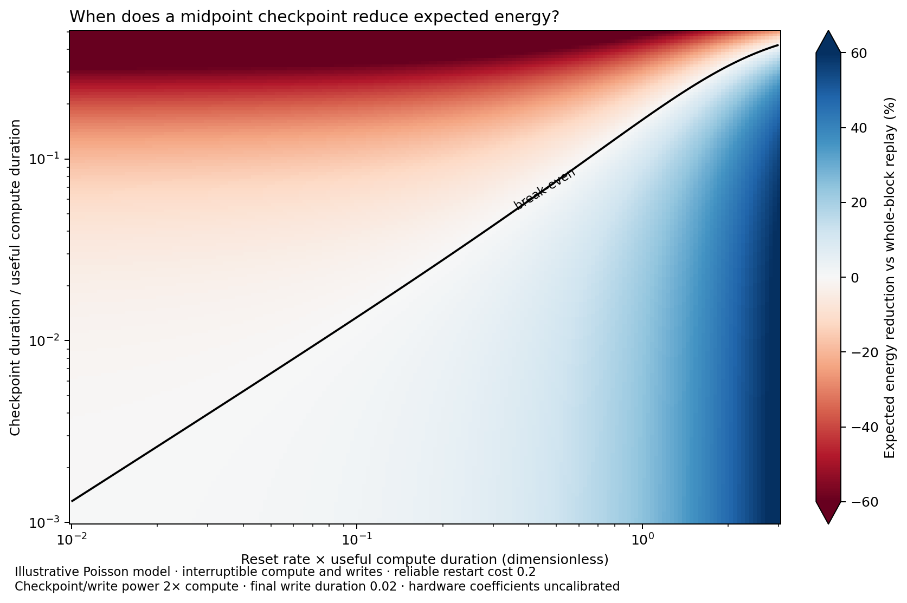

# Nghiên cứu phát triển RECAP-CIM theo xu hướng 2026

Ngày khảo sát 11/11/2026. Hướng đề xuất là **tối ưu tiến độ suy luận bền vững và tỷ lệ kết quả đúng hạn trên SRAM-CIM, có xét nạp lại trọng số và mất nguồn trong thao tác**. Đây là giả thuyết đóng góp cần được kiểm bằng G9. Project hiện đã có runtime, kiểm đúng số học và publisher RTL để thực hiện bước nghiên cứu đó trên máy tính.

Mình đã đối chiếu 31 nguồn gốc, gồm paper/bản tác giả, preprint, kho mã tác giả, benchmark, tài liệu hãng, tiêu chuẩn và hướng dẫn công bố. Các nguồn được đọc ở mức khác nhau, từ full text/đoạn phương pháp đến abstract hoặc preview. Danh mục ghi rõ mức truy cập, chỗ dùng bằng chứng và giới hạn. Khảo sát ưu tiên khoảng trống có thể làm từ G8. [Danh mục nguồn máy đọc](research_sources_2026-11-11.json).

**Các nhu cầu xã hội liên quan trực tiếp nhất là giảm bảo trì cảm biến, xử lý thông tin ngay tại nơi thu thập và hoạt động hữu ích khi nguồn điện hạn chế.** IEA cập nhật năm 2026 dự báo điện cho data centre từ khoảng 485 TWh năm 2025 lên 950 TWh năm 2030. Đây là bối cảnh tạo sức ép đo hiệu quả năng lượng AI. Lợi ích của cảm biến TinyML phải được đánh giá bằng workload và ranh giới năng lượng cụ thể. [IEA 2026, executive summary](https://www.iea.org/reports/key-questions-on-energy-and-ai/executive-summary).

ITU ghi nhận 62 triệu tấn rác điện tử năm 2022 và 22,3% được thu gom/tái chế chính thức. Một thiết bị ít thay pin có thể giảm công bảo trì, nhưng hiệu quả vật liệu còn phụ thuộc harvester, tụ, cảm biến, NVM, vòng đời và xử lý cuối đời. Vì vậy, project nên báo số lượt bảo trì hoặc linh kiện thay thế theo một kịch bản công khai trước khi chuyển kết quả năng lượng thành claim carbon. [ITU, Global E-waste Monitor 2024](https://www.itu.int/en/ITU-D/Environment/Pages/Publications/The-Global-E-Waste-Monitor-2024.aspx).

Ambient IoT đã đi vào tiêu chuẩn hóa, với TS 38.291 thuộc 3GPP Release 19. Điều này tạo bối cảnh ứng dụng cho thiết bị năng lượng thấp và việc trao đổi sự kiện ngắn. Ngân sách năng lượng của từng loại tag/cảm biến vẫn phải được xác định riêng trước khi ghép một CNN vào mô hình. [3GPP TS 38.291](https://portal.3gpp.org/desktopmodules/Specifications/SpecificationDetails.aspx?specificationId=4393).

| Bối cảnh ứng dụng đề xuất | Vấn đề cần giải quyết | Phần tái dùng từ project | Bằng chứng cần bổ sung |
|---|---|---|---|
| Cảm biến có người trong phòng, dùng nguồn thu ánh sáng | Trả event trước khi thông tin hiện diện hết giá trị, giảm thay pin ở nhiều vị trí | VWW INT8, runtime và durable log | Capture/idle/preprocessing, nguồn theo vị trí, deadline, chi phí gửi event |
| Giám sát âm thanh máy móc hoặc môi trường | Bỏ lỡ sự kiện khi sạc lại, chi phí nghe liên tục và giữ cửa sổ tín hiệu | KWS hiện có và cơ chế phục hồi | Trace âm thanh liên tục, capture buffer, preprocessing và event-level metrics |
| Cảm biến nông nghiệp/sinh thái đặt xa | Bảo trì và kết nối khó, cần hoạt động theo mùa/giờ có năng lượng | Source model và runtime có thể tái dùng | Dữ liệu thực tại vị trí, budget sensor/radio, thời gian đáp ứng của tác vụ |

Các ứng dụng trong bảng là đề xuất định hướng cho project. Nhu cầu triển khai cụ thể tại Việt Nam và mức tiết kiệm bảo trì chưa được khảo sát thực địa. Ứng viên đầu tiên hợp lý là occupancy với VWW vì tận dụng được nhiều phần hiện có. Acoustic monitoring phù hợp làm bước mở rộng sau khi có pipeline âm thanh liên tục.

**Xu hướng kỹ thuật đang làm ranh giới bài toán thay đổi.** MCU tích hợp NPU và toolchain triển khai đã trở thành nền tham chiếu thực tế cho edge AI. STM32N6 là ví dụ thương mại có NPU và bộ nhớ lớn hơn budget G8. Các con số peak của sản phẩm chỉ giúp đặt bối cảnh cạnh tranh. Phép so với RECAP cần cùng model, precision, ranh giới nguồn, công việc hoàn tất và energy accounting. [ST, STM32N6](https://www.st.com/en/microcontrollers-microprocessors/stm32n6-series.html).

MLPerf Tiny v1.4, công bố tháng 7/2026, bao gồm năm benchmark. Streaming wake word đã được thêm từ v1.3 và tính cả hành vi idle/listening. Điều này củng cố việc mở rộng metric từ một inference đã chuẩn bị sẵn sang một pipeline nghe và trả kết quả theo thời gian. Với G8, sensing/preprocessing và hàng đợi input đang ở ngoài ranh giới mô hình. Đưa chúng vào có thể làm đổi tỷ trọng lợi ích của checkpoint. [MLCommons, MLPerf Tiny v1.4](https://mlcommons.org/2026/07/mlperf-tiny-v1-4-results/).

Preprint ngày 2/11/2026, “TinyML Hits the Memory Wall”, báo cáo mối liên hệ giữa memory traffic và latency trên bốn accelerator trong một suite CNN nhỏ. Tác giả dùng chỉ tiêu energy above idle, nên muốn so với G8 cần làm rõ phần idle và nền hệ thống. Kết quả gợi ý nên đo byte di chuyển/nạp lại trọng số cùng MAC. Quy mô suite và trạng thái preprint giới hạn sức khái quát của kết luận. [Bản tác giả v1](https://arxiv.org/html/2611.03392v1).

CIM-Tuner mô tả rõ băng thông tính toán đầu vào và cập nhật trọng số, cùng tiling hai mức. AccelCIM mở rộng phân tích sang dataflow, interconnect, macro/array và compute-I/O overlap. Hai hướng này tạo áp lực cho G9 phải mô hình hóa reload/utilization ở cấp hệ thống. Chúng cũng cung cấp nền để định nghĩa backend khi so checkpoint. [CIM-Tuner, §§III–IV](https://arxiv.org/html/2601.18070v1) · [AccelCIM, §§3–4](https://arxiv.org/html/2604.17692v1).

**Prior art đã chiếm nhiều ý tưởng chung của lĩnh vực.** Bảng dưới dùng công trình theo cơ chế để xác định phần G9 còn cần chứng minh. Các adaptation đề xuất sẽ có giá trị làm đối chứng sau khi được hiện thực và xác minh.

| Nguồn | Điều đã có | Ảnh hưởng tới đóng góp RECAP-CIM |
|---|---|---|
| Chime, 2016 | Đặt checkpoint có tối ưu chi phí lưu và tính lại, điều chỉnh theo năng lượng | Cần đối chiếu hàm mục tiêu và giải pháp tối ưu thay vì chỉ so control định kỳ. [Nguồn tác giả](https://www.microsoft.com/en-us/research/?p=549888) |
| iNAS, 2021 | Đồng khám phá kiến trúc mạng, execution và preservation | Claim “đồng tối ưu mapping/checkpoint” cần đặc tả khác biệt cụ thể ở state và hành động SRAM-CIM. [Kho tác giả](https://github.com/EMCLab-Sinica/Intermittent-aware-NAS) |
| CHRYSALIS, 2024 | Đồng tối ưu nguồn, phần cứng suy luận và dataflow/tiling có checkpoint | Cần so cùng budget nguồn/bộ nhớ và định nghĩa phần G9 bổ sung. [Cơ quan tác giả](https://researchportal.hkust.edu.hk/en/publications/a-tale-of-two-domains-exploring-efficient-architecture-design-for/) |
| Circadia, 2026 | Khai thác control/dataflow tĩnh và live state của CNN để đặt checkpoint | Là đối chứng gần cho lựa chọn granularity và vị trí checkpoint. [Publisher](https://doi.org/10.1016/j.micpro.2026.105322) |
| HAWAII, 2020 | Bảo toàn tiến độ suy luận bằng footprint | Giảm metadata và phục hồi đúng cần so với cơ chế progress indicator đã có. [Kho tác giả](https://github.com/EMCLab-Sinica/HAWAII_Project) |
| BISen, 2026 | State machine năng lượng và selective CNN state, safe-stop trước brownout | Cần đối chứng thuộc nhóm reactive khi nghiên cứu nguồn có dự báo/đo điện áp. [Publisher](https://ieeexplore.ieee.org/document/11421036) |
| Viadotto, 2025 | CIM trên CRAM, tích hợp compiler/controller với nền batteryless | Sự khác nhau giữa bộ nhớ giữ trạng thái và SRAM mất bank là biến nghiên cứu cần cô lập. [PDF từ cơ quan tác giả](https://imec-publications.be/server/api/core/bitstreams/d647c609-d6f6-4f7f-b851-f19a1cc1a2ff/content) |
| FreeML, 2024 | Nén model và shared early-exit branch | Nhánh đánh đổi accuracy cần quy định output/quality mới khi mở rộng G9. [Bản tác giả](https://arxiv.org/html/2405.10426v1) |
| DualAdaptNet, DATE 2025 | Thích nghi width/depth và lịch chạy theo nguồn/deadline | Kết hợp deadline với thích nghi inference đã có tiền lệ. [Abstract từ đại học tác giả](https://eprints.soton.ac.uk/497948/) |
| NodPA, 2025 | Giữ indicator cho tiến độ dynamic network | Thay đổi đường chạy hoặc bỏ layer tạo thêm thông tin phải phục hồi chính xác. [Publisher](https://doi.org/10.1145/3757917) |
| ISQED 2025 checkpoint-free inference | Giữ loop indices và dữ liệu trung gian bền vững, bảo đảm idempotence | So các transaction/atomic region thực hiện thay vì suy lợi ích từ tên cơ chế. [Proceedings](https://www.isqed.org/English/Proceedings/pdf/6C-2-173.pdf) |
| INTERCEPT, SenSys 2024 | Đặt/configure persistence dựa trên write-error/energy của STT-MRAM và quality budget | Persistence có approximation là một nhánh riêng cần cost và error model đúng công nghệ. [Bản tác giả](https://www.diva-portal.org/smash/get/diva2%3A1963403/FULLTEXT01.pdf) |

**Hai nhóm công trình mới làm việc mở rộng theo retention và precision cần được cân nhắc kỹ.** TotalRecall, ASPLOS 2020, khai thác charge còn lại để giữ SRAM qua một số khoảng tắt và dùng NVM fallback. RIPPLE, công bố tháng 2/2026, kết hợp backup theo năng lượng và kiểm retained SRAM. Từ đó, proposal G9 nên mô tả hai miền riêng trong cùng power model, gồm mất bank hoàn toàn và off interval còn giữ bank có kiểm chứng. Số liệu của MCU SRAM sẽ cần xác minh lại khi áp dụng cho macro SRAM-CIM và rail riêng của nó. [TotalRecall](https://harriswms.github.io/files/ForgetFailure.pdf) · [RIPPLE](https://link.springer.com/article/10.1007/s11227-025-08205-7).

FERMI-ML dùng cấu trúc digital với accumulator approximate và báo kết quả post-layout. SLICE-CiM, preprint ngày 27/10/2026, tập trung vào điều khiển precision, bit slice và early termination trong accumulation. Hai nguồn cho thấy precision/control là hướng đang được khai thác. Thay precision có thể đổi chi phí checkpoint, độ dài phép tính và output, nên chỉ đưa vào sau khi đã ổn định hợp đồng chính xác của G9. [FERMI-ML](https://arxiv.org/html/2511.12544v1) · [SLICE-CiM](https://arxiv.org/html/2610.37601v1).

**Khoảng trống nên theo đuổi là sự tương tác giữa trạng thái bền vững và trọng số cư trú trong một khối fused DW–PW.** Một mapper tối ưu chi phí khi cấp nguồn liên tục có thể chọn tile reuse tốt nhưng mất nhiều tiến độ khi reset. Một checkpoint policy độc lập với mapping có thể lưu trạng thái lớn trong khi chi phí chính nằm ở cold reload. Giả thuyết cần kiểm là cùng quyết định lưu DW/PS sẽ đổi thứ tự tốt/xấu khi geometry, bank residency, thời điểm mất nguồn hoặc chi phí transaction thay đổi. Phát biểu này là đề xuất suy ra từ các cơ chế đã đối chiếu, và chưa được xác nhận là đóng góp mới.

| Câu hỏi nghiên cứu | Thí nghiệm quyết định | Điều có thể bác bỏ giả thuyết |
|---|---|---|
| RQ1. Lưu DW hoặc PS có lợi trong miền chi phí/phần cứng nào? | Cùng geometry/frontier, ép đủ bốn tổ hợp lưu/bỏ, cắt giữa compute/write/reload | Mọi hành động lưu đều bị phương án replay trội hơn trong các profile có căn cứ |
| RQ2. Biết weight-bank còn hay mất có đổi lựa chọn không? | Factorial giữ/hủy bank kết hợp policy có/không xét residency | Các quyết định và endpoint vẫn hòa sau khi kiểm cost model đầy đủ |
| RQ3. Mô hình reset giữa thao tác có giảm sai lựa chọn của ranking G8 không? | Oracle nhỏ và so regret giữa ranking cũ/mới, gồm single-chunk tile | Ranking mới tăng overhead nhưng không cải thiện regret hoặc endpoint |
| RQ4. Lợi ích trên block có duy trì ở KWS/VWW và nguồn khác không? | Policy khóa trước main, nguồn và input độc lập với development | Hiệu quả chỉ tồn tại ở shape, coefficient hoặc trace đã dùng chọn policy |
| RQ5. Có tăng số kết quả hữu ích đúng hạn ở cấp node không? | Thêm sensing/preprocess/idle/report, đánh giá theo mọi sự kiện đến | Phần tiết kiệm checkpoint quá nhỏ so chi phí pipeline hoặc làm tăng bỏ lỡ sự kiện |

G8 hiện cung cấp bằng chứng đúng chức năng nhưng chưa trả lời khẳng định RQ1–RQ4. Trên tập chính, `RECAP_redo` và `RECAP_nominal` có histogram quyết định giống nhau ở 56 cặp workload–kịch bản. So B3, commit và đúng hạn khớp từng cặp, sai khác năng lượng lớn nhất khoảng 2,19 × 10⁻¹⁴ J. Các lần chọn lưu DW/PS của RECAP đều bằng 0. Kết quả này đặt trọng tâm vòng tới vào kiểm cơ chế và mô hình decision. [Kiểm nghiệm G8](G8_review_2026-11-11.md).

Một nguyên nhân cần thử là ranking hiện không có nhánh reset trong final segment và cộng DW/prologue ngoài renewal. Với tile một chunk, mô hình ranking vì vậy chưa phạt rủi ro bị cắt ở đoạn tính và publish cuối. Mô phỏng G8 vẫn có thể cắt các thao tác đó. Chênh lệch giữa hai mức mô hình cần được đo bằng regret và lịch sử state, cùng với chi phí boot scan, cold reload và recharge.

Mình đã truy vấn thêm 21 stage của hai model với bank trống, tụ 100 µJ đầy và frontier đầu stage trong cost G8 hiện hành. 17 stage fused có thời lượng tile danh định từ 0,130 đến 4,299 ms. Với hazard planner 2 Hz, xác suất Poisson có reset trong thời lượng tile này chỉ khoảng 0,026–0,856%. Đây là một lời giải thích khả dĩ cho việc ghi thêm DW/PS khó bù được chi phí trong cấu hình hiện tại. Diagnostic chỉ xét tile đầu mỗi stage và loại thời gian chờ/boot scan. Cần oracle và transition đầy đủ để kết luận phương án tốt nhất. [Diagnostic theo stage](../10_Experiments/research_20261111/planner_scale_probe.json) · [Script tái lập](../10_Experiments/research_20261111/planner_scale_probe.py).

**Mình đã thực hiện một kiểm tra toán học mới để chuẩn bị cho G9.** Mô hình phụ dùng reset Poisson, công suất hằng từng phase, các biên đã publish được giữ bền vững và reboot có chi phí cố định, đáng tin cậy. Toàn bộ compute và write đều có thể bị cắt. Mục đích là kiểm logic expected-redo với một mô hình có nghiệm giải tích.

Với một segment cần thời gian t, công suất P, reset rate λ và chi phí reboot b, nếu reset làm chạy lại segment từ đầu thì kỳ vọng năng lượng là

\[
\mathbb{E}[E]=P\frac{e^{\lambda t}-1}{\lambda}+b(e^{\lambda t}-1).
\]

Giới hạn khi λ tiến về 0 là Pt. Với công suất thay đổi giữa compute và write, tích phân năng lượng attempt theo xác suất sống còn cho cùng dạng renewal. Một checkpoint thành công chia công việc thành hai segment có thể phục hồi độc lập. Reset trong lúc ghi checkpoint quay về biên trước đó. Công thức phản ánh việc một segment đơn lẻ vẫn có nguy cơ tính lại.

Mình kiểm tám trường hợp bằng Monte Carlo, mỗi trường hợp 100.000 lần hoàn tất. Sai lệch trung bình giải tích/mô phỏng lớn nhất bằng 1,37 standard error. Các kiểm tra closed form và giới hạn λ=0 đạt. Script và kết quả có hash để tái lập. Hệ số của mô hình này là số không thứ nguyên được chọn để minh họa, với thời gian compute chuẩn hóa bằng 1, thời gian checkpoint 0,05, công suất ghi gấp đôi compute, final write 0,02 và reboot cost 0,2. [Script](../10_Experiments/research_20261111/renewal_probe.py) · [Kết quả](../10_Experiments/research_20261111/renewal_probe.json).

| λ × thời gian compute | Thay đổi năng lượng kỳ vọng khi có checkpoint giữa block |
|---:|---:|
| 0,01 | Tăng 9,33% |
| 0,10 | Tăng 6,81% |
| 0,50 | Giảm 4,27% |
| 1,00 | Giảm 17,61% |
| 3,00 | Giảm 60,20% |

Các số trong bảng thuộc mô hình phụ. Mô hình còn thiếu capacitor/recharge, state DW/PS thật, deadline, lỗi bộ nhớ và reset trong recovery. Bước tiếp theo là đưa chi phí và state thực vào oracle, rồi so sự thay đổi lựa chọn với runtime. Kết quả minh họa cho thấy tìm ranh giới có lợi/không có lợi là một cách kiểm giả thuyết trực tiếp, thay vì chỉ tìm một mức giảm năng lượng tổng hợp.

**Backend có căn cứ nên được xây ở mức per-action trước.** Cần có chi phí compute, weight update/bank load, đọc/ghi NVM theo transaction, boot, scan, control và các trạng thái idle/retention. Từng giá trị đi cùng precision, voltage/frequency, capacity, nguồn và phạm vi đo. G8 hiện kế thừa hệ số DW ×30 của cost debug, nên số năng lượng đang cho biết hành vi trong mô hình đó. Profile G9 cần được xây mới và gắn provenance từng trường.

| Công cụ/nguồn | Cách dùng đề nghị | Điểm phải kiểm trước khi tích hợp |
|---|---|---|
| ZigZag-IMC | Xuất estimate per-layer/per-action cho một cấu hình digital SRAM-CIM có arithmetic phù hợp | Repo nêu ràng buộc 6T, integer, adder tree không approximation và các điều kiện điện áp/model. Kiểm phiên bản vì thông báo maintenance có thay đổi. [Repo tác giả](https://github.com/KULeuven-MICAS/zigzag-imc) |
| AccelForge + HWComponents | Một đường thay thế để mô tả architecture/mapping và lấy component energy/latency | Bắt đầu bằng một layer, pin version và cross-check công thức/counter. CiMLoop hiện hướng người dùng sang hai dự án này. [CiMLoop maintenance](https://github.com/mit-emze/cimloop) · [AccelForge](https://github.com/Accelergy-Project/accelforge) · [HWComponents](https://github.com/Accelergy-Project/hwcomponents) |
| Datasheet NVM | Tính transaction energy/time theo opcode, địa chỉ, payload và power state | FM25V20A là 2 Mbit, tương đương 256 KiB. Thiết kế backing store 2 MiB của G8 cần capacity/controller tương ứng. [Hãng](https://www.infineon.com/part/FM25V20A-G) · [Audit datasheet của project](hardware_selection/sram_cim_nvm_selection.md) |

Mình đã đọc HEAD từ các repo và lưu commit vào danh mục nguồn. Việc cài/chạy backend và xác minh output per-action vẫn thuộc triển khai G9. Với workspace Windows hiện tại, repo ZigZag-IMC ghi CACTI cần Linux hoặc cost bộ nhớ do người dùng cung cấp. Có thể chuẩn bị môi trường riêng rồi xuất profile có version vào runtime. Việc khớp model với một macro cụ thể và phép đo vẫn cần thực hiện sau bước integration.

**Thứ tự phát triển nên bám vào các câu hỏi có thể kiểm được.** Độ ưu tiên dưới đây là đánh giá từ khả năng tái dùng G8, mức gần prior art và nguồn lực máy tính hiện có.

| Hướng | Ưu tiên | Cơ sở lựa chọn | Điều kiện để mở rộng |
|---|---|---|---|
| Expected-redo có reset trong thao tác, residency và oracle | Cao nhất | Giải quyết trực tiếp chênh lệch ranking/execution và giả thuyết DW/PS | Oracle, baseline và profile có căn cứ cho thấy quyết định có ý nghĩa |
| Deadline và pipeline occupancy | Cao, sau cơ chế block | VWW đã chạy, endpoint dễ gắn nhu cầu người dùng | Bổ sung năng lượng capture/preprocess/idle/report |
| Streaming wake word, state liên cửa sổ | Trung hạn | Benchmark đang phát triển và KWS có nền sẵn | Adapter graph mới, timestamp/input loss và listening energy |
| SRAM-CIM retention và phân biệt brownout/rail-off | Trung hạn, giá trị khoa học tiềm năng | Có thể đổi chi phí cold reload và lựa chọn checkpoint | Có profile rail/retention đủ tin cậy hoặc đối tác đo |
| Precision/early exit | Mở rộng có điều kiện | Đã có nhiều prior art, làm đổi quality contract | Đánh giá accuracy–timeliness–energy và indicator recovery mới |
| Multi-node cooperative inference, on-device learning | Dài hạn | Câu hỏi nguồn/giao tiếp/trạng thái lớn hơn | Nền G9 ổn định và có bài toán ứng dụng đòi hỏi rõ |

**Lộ trình khả thi cho một người trên máy tính là khoảng 10–12 tuần làm việc tập trung**, với thứ tự có phụ thuộc. Đây là dự toán công việc, cần điều chỉnh theo thời gian thực có thể dành cho project.

1. Tuần 1–2 tạo snapshot có commit, sửa B4 restore trong nhánh G9, đọc sâu và viết state/action/objective mapping của Chime/Circadia. Chuẩn bị profile cost và chạy một layer qua backend được chọn.
2. Tuần 3–4 dựng oracle DW–PW và kiểm đầy đủ bốn action, cold/warm bank, cắt trong compute/write. Xuất bản đồ miền lợi ích và xác định điểm ranking hiện chọn sai. Giữ rõ miền dùng hệ số giả định.
3. Tuần 5–6 triển khai bộ chọn G9 từ oracle hoặc lookup, bổ sung baseline tĩnh tối ưu và reactive có phạm vi. Đo overhead quyết định, SRAM/NVM thật của lookup/controller và correctness dưới reset.
4. Tuần 7–8 khóa protocol/holdout mới, chạy KWS/VWW trên các nhóm nguồn, report pairing/CI và mọi ca thua/incomplete. Kiểm lại cost/residency ablations.
5. Tuần 9–10 bổ sung pipeline occupancy và tái lập ở môi trường tách biệt. Nếu có khả năng đo, power-cycle controller/NVM để xác minh ACK, torn writes và energy ledger.
6. Tuần 11–12 chọn claim theo kết quả, nhờ giảng viên/nhóm nghiên cứu phản biện độc lập và viết lại manuscript. Nếu RQ1–RQ4 vẫn hòa, ưu tiên phân tích ranh giới hoặc sửa hypothesis trước khi tăng quy mô RTL.

Protocol chi tiết đi kèm xác định state, action, đối chứng, endpoint, ràng buộc freeze và grid dự toán. Hiện protocol đang ở trạng thái draft, có các tham số cần chốt từ development. [Đề xuất G9](../03_Architecture/G9_research_protocol_draft.md).

**Cơ hội paper nằm ở một cơ chế mới được chứng minh và giải thích đủ rõ.** Một tên đề tài làm việc phù hợp là “Weight-residency-aware recovery scheduling for intermittent SRAM-CIM inference”. Tên này xác định đúng biến cần chứng minh. Claim dự kiến có thể nói rằng jointly chọn geometry và trạng thái DW/PS, với transition cold reload và mất nguồn trong thao tác, làm tăng tiến độ đúng hạn trên một miền nguồn/chi phí được xác định. Chỉ điền mức cải thiện sau khi có kết quả đối chứng đã khóa.

IEEE ESL phù hợp khi đóng góp thu hẹp thành một kết quả có ý tưởng mới, chiều sâu kỹ thuật và đủ bằng chứng trong tối đa bốn trang. TCAD phù hợp về scope nếu project phát triển thành thuật toán/công cụ automated design có đánh giá rộng hơn. Điều kiện khoa học hiện còn ở oracle, baseline, cost provenance, generalization và review độc lập. Nộp bài sẽ được quyết định theo kết quả mới. [ESL author instructions](https://ieee-ceda.org/publication/esl/esl-author-instructions) · [TCAD submission instructions](https://ieee-ceda.org/publications/tcad/tcad-paper-submissions).

**Các giới hạn truy cập có ảnh hưởng tới mức chắc chắn của khảo sát.** Circadia hiện đọc được abstract và section previews, artifact Inria bị chặn truy cập. DualAdaptNet có abstract từ đại học và bản accepted manuscript còn embargo tại ngày khảo sát. NodPA và BISen có publisher-indexed excerpts, một số lần mở trực tiếp bị 403/JavaScript hoặc lỗi staging. RIPPLE có abstract và repo được dẫn từ bài, nhưng repo GitHub đang rỗng. Các công trình này đã đủ để xác định sự giao nhau về cơ chế. Bản adaptation trung thực cần đọc/đối chiếu full method trước khi dùng làm kết quả so sánh.

Các bản preprint mới như TinyML Memory Wall và SLICE-CiM được dùng làm tín hiệu nghiên cứu và nguồn phương pháp có giới hạn theo phiên bản đã xem. Đợt này hoàn thành khảo sát, thiết kế nghiên cứu và diagnostic renewal riêng. Kết quả triển khai/hiệu quả của G9 sẽ cần đo trong vòng tiếp theo.
