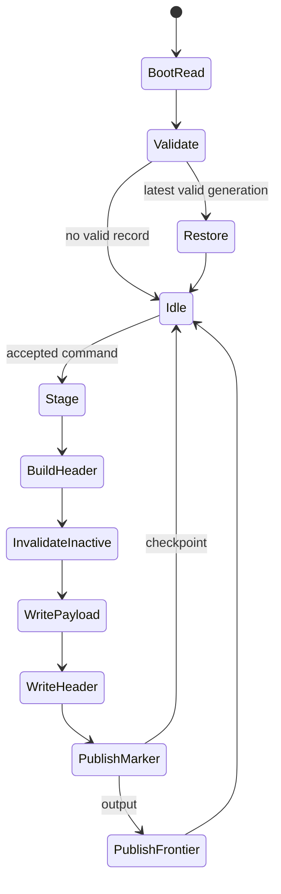

# G4 — RTL checkpoint controller và đối chiếu transaction

## 1. Phạm vi bằng chứng

G4 hiện thực **controller một microtile** bằng SystemVerilog, giao tiếp
NVM byte với persistence ACK, SRAM staging/restore port và command từ
runtime. Hai scalar arithmetic cores MAC/requant được kiểm tra riêng.
Backend DW–PW trong testbench là mô hình số học SystemVerilog đọc tensor
thật; không phải physical SRAM-CIM macro hoặc datapath accelerator đã
tích hợp. Admission/mapping vẫn do host cung cấp trước command.

Không thay RTL legacy hoặc dùng các thông số hiệu năng legacy. G4 chưa
tích hợp queue nhiều input, input/weight DMA, SPI/FRAM driver, sensing,
power management hoặc toàn bộ KWS. Không chuyển cycle count thành joule.

## 2. Modules và interface

| File | Vai trò |
|---|---|
| `04_RTL/g4/recap_checkpoint_ctrl.sv` | Boot/validate, restore, COW staging, publication và output frontier |
| `04_RTL/g4/recap_int8_mac.sv` | Serial INT8 MAC, adjusted activation signed 9 bit, INT32 accumulator, overflow detect |
| `04_RTL/g4/recap_requantize.sv` | Gemmlowp hai lần làm tròn, activation clamp, shift-overflow detect |
| `09_Simulation/g4/tb_checkpoint.sv` | Backend DW–PW functional, retained NVM, bus/backpressure, fault injection và assertions |
| `09_Simulation/g4/tb_arithmetic.sv` | Real-model và seeded arithmetic vectors |
| `09_Simulation/g4_reference.py`, `g4_trace_check.py` | Codec/transaction/cycle oracle độc lập bằng Python |

Command gồm `save_z`, `keep_ps`, `output`, `offset`; payload SRAM có layout
`[Z INT8][PS little-endian INT32][output INT8]`. Runtime giữ payload ổn
định tới `commit_done`. SRAM read port hiện giả định combinational; SRAM
đồng bộ một chu kỳ cần adapter và kiểm tra timing mới.

NVM chỉ có một outstanding byte request. `mem_valid` và address/data/write
phải giữ khi chưa `mem_ready`. Ready của write nghĩa là byte đã persistent;
ready của read nghĩa là data hợp lệ. Đây là hợp đồng backend, không phải
giao diện SPI/FRAM đã xác minh từ datasheet.

Model/input/descriptor IDs giữ ổn định trong một lần chạy. Descriptor ID
là SHA-256 của descriptor/arithmetic/layout identity, không cắt hash xuống
32 bit. Một controller instance điều khiển một slot window/frontier;
runtime multi-descriptor/address translation thuộc bước tích hợp sau.

## 3. Binary-v1: refinement của semantics G2/G3

G2/G3 dùng metadata JSON + SHA-256 payload. RTL dùng header nhị phân
**124 byte**, CRC32 payload/metadata và full 256-bit identities. Đây là
semantic refinement, **không phải file-format hoặc traffic equivalence**.
CRC32 không có mức bảo vệ collision như SHA-256; không nhận tính đúng
trước corruption cố tình tạo checksum collision.

| Offset byte | Nội dung |
|---|---|
| 0 | Atomic publication marker, `0xA5` |
| 1 / 2 / 3 | Version=1 / flags Z,PS,output / reserved=0 |
| 4–7 | Generation uint32, little-endian |
| 8–39 / 40–71 / 72–103 | Model / input / descriptor identities, mỗi ID 32 B |
| 104–107 | Durable PW prefix offset uint32 |
| 108–109 / 110–111 / 112–113 | Z / PS / output byte lengths uint16 |
| 114–115 | Reserved=0 |
| 116–119 | CRC32(payload) |
| 120–123 | CRC32(header bytes 1..119) |
| 124.. | Payload, chỉ các vùng hợp lệ đã chọn |

Hai slots mỗi slot 512 B; completion byte tại address 1024. Cold boot
đọc đủ 1025 B trong cấu hình kiểm tra, kiểm CRC/identity/layout/length,
chọn generation hợp lệ lớn nhất, rồi restore payload tới SRAM.



Power loss từ bất kỳ state nào reset volatile control/SRAM-valid state;
NVM giữ byte đã persistent. Không dùng offset trong header chưa publish.
Nếu output đã publish nhưng completion byte chưa có, boot restore output
và hoàn tất frontier publication. Frontier orphan không có valid output
phải fail closed. Generation wrap cũng bị từ chối, không tái dùng số cũ.

Nếu runtime đã tính prefix 32 nhưng `keep_ps=false` trong khi durable PS
cũ ở 16, controller copy **PS cũ và offset 16** vào slot mới. Tương tự Z
cũ có thể được bảo toàn. Old slot không bị overwrite trước marker ACK.

## 4. Giả định mất nguồn

- Một byte marker/frontier là atomic old-or-new; ACK chỉ sau persistence.
- Chỉ một outstanding request, không reorder và không có delayed write
  từ trước reset hoàn tất bất ngờ sau boot.
- Pending write bị cắt có thể chưa persistent hoặc đã persistent trước
  ACK; testbench thử cả hai, gồm chính marker và frontier.
- Byte data khác có corruption tests qua CRC. Chưa thử mọi bit pattern,
  checksum collision, mọi sequence vô hạn hoặc analog brownout behavior.

Atomicity/ordering này vẫn chưa được chứng minh trên FM25V20A thực tế.
Controller buffers không cần reset về giá trị biết trước; chỉ được dùng
sau staging/validated restore. Functional backend của testbench xóa
Z/PS/output volatile khi cold loss.

## 5. Cross-check và cycle model

Oracle Python dùng `struct`/`zlib` tạo bytes từ golden tensors và command
intent, không lấy expected bytes từ RTL output. Mỗi acknowledged read,
write, pending-but-persisted write và restore byte được kiểm tra theo
thứ tự. Sau fault oracle khởi động lại từ **NVM bytes thật còn lại**, không
chỉ dùng metadata/tag của host.

Với payload L byte và f=1 cho final output, mỗi commit ghi:

```text
NVM byte writes = L + 125 + f
commit latency = 2*L + 246 + f + stalled bus cycles
```

Latency đo từ command acceptance tới `commit_done`; gồm SRAM staging,
CRC/header build và persistence ACK. Không gồm DW/PW computation, boot,
weight loads, input transfer hoặc source charging. Testbench có cả zero
stall và random bounded stalls. Restore có backpressure riêng.

Ví dụ output commit zero-stall: G2 output 16 B → 279 cycles; G3 tile
output 32 B → 311 cycles. Đây là cycles của protocol trong hợp đồng bus
nêu trên, không phải latency MCU/FPGA/ASIC ở một tần số đã xác minh.

## 6. Verification và giới hạn synthesis

Hai model-backed fixtures: G2 2×2/CO4 và spatial tile G3 1×2/CO16, CI64.
CI16 kiểm cả bốn save flags; CI64/output-only được kiểm riêng bằng driver
variant có duy nhất chunk constant đổi 16→64, controller không thay đổi.

Assertions mô phỏng kiểm stable request khi stall, address bounds, command
sau boot, không invalidate active slot, frontier sau output publication,
durable offset/generation chỉ đổi khi chọn record hợp lệ hoặc publish,
và toàn bộ output tensor khớp INT8 golden. Có directed tests cho CRC,
identity, old PS prefix, generation wrap và orphan frontier.

Yosys đã chạy `proc/opt/memory_collect/check -assert` cho MAC/requant và
controller **giảm kích thước** Z4/PS4/OUT1/C4/SLOT160. Đây là generic
process/structure check, chưa technology mapping. Cấu hình controller
đầy đủ Z128/PS128/OUT32 đã timeout 180 s; không nhận đã qua synthesis.
Snapshot/byte-array decode hiện tạo logic lớn và cần tối ưu parser/memory
architecture trước khi nhận khả năng triển khai hiệu quả.

Không có standard-cell library, timing constraints/P&R hoặc physical
power validation. Không có area mm², fmax, ASIC power/TOPS/W và không có
formal proof. Các invariants đã kiểm tra là bằng chứng simulation hữu hạn.
